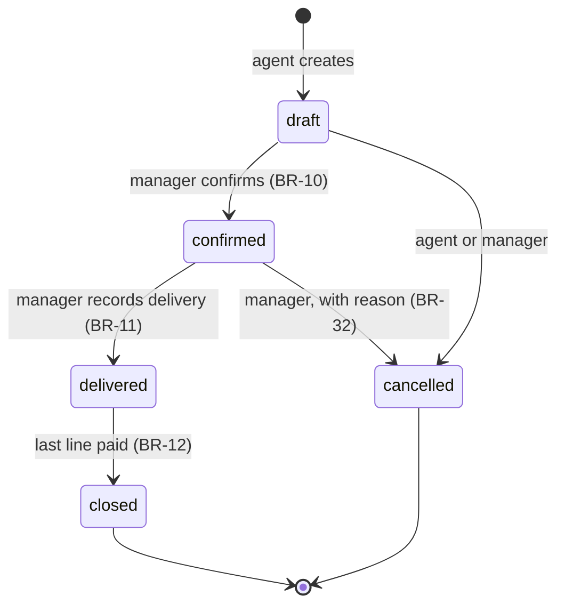
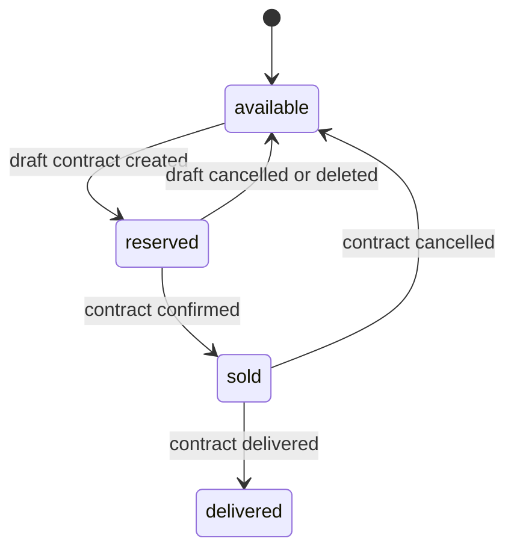

# Story intake — 02-core-models

> **Source:** manual entry (no tracker). Rules, user stories and acceptance criteria below are pasted
> verbatim from `docs/business-requirements.md` v0.2 — if they ever disagree, that document wins.

---

## Feature

- **Feature name (display):** Real estate installments & collections
- **Feature slug (folder under `plans/`):** `installments`

## Tracker (metadata only)

- **Tracker type:** `none`
- **Work item id:** `02-core-models`

---

## Title

Core models, views, states and access rights

---

## Description

Build the three core models — project, unit and contract — with their list, form and search views
and menus, the customer identity fields on contacts, and the contract state machine (draft →
confirmed → delivered → closed, plus cancelled) with the manager-only actions.

Odoo hygiene is part of the story, not a later cleanup: contract reference from a sequence,
`company_id` and `currency_id` on every model, Monetary fields, deletion blocked for non-draft
contracts, chatter on contracts, and the one-live-contract-per-unit rule enforced in the database.

Security groups and access rights (ACLs) land here too — agent, manager, collections officer, with
accountants using Odoo's own groups — so that every test from this story on runs as a real
non-admin user. Record rules (who sees which records) wait for Story 06.

---

## Acceptance criteria

### User stories

**US-01 — Create a contract for an available unit**
*As a **sales agent**, I want to create a contract for an available unit and a customer, so that the
unit is held for that customer while the deal is finalised.*

**US-09 — Cancel a contract**
*As a **sales manager**, I want to cancel a contract with the retention computed, so that the unit
can be resold and the accountant knows what to refund.*

**US-10 — Confirm a contract**
*As a **sales manager**, I want to approve each contract before it becomes binding, so that no deal is
committed without a check.*

**US-11 — Record delivery of the unit**
*As a **sales manager**, I want to record the handover date, so that the maintenance deposit falls
due and the unit shows as delivered.*

**US-06 — Agents see only their own contracts**
*As a **sales manager**, I want each agent to see only their own contracts while I see all, so that
customer data and deals stay with the person responsible.*

### Business rules

| ID | Rule |
|---|---|
| BR-01 | A unit belongs to exactly one project. A unit's code is unique within its company. |
| BR-02 | A unit has a type, area (m²), floor and **list price** (EGP). Price per m² is shown, computed from list price ÷ area. |
| BR-03 | A unit's status — **available, reserved, sold, delivered** — is derived from its contract and is never typed by hand: no live contract → available; draft contract → reserved; confirmed → sold; delivered or closed → delivered. |
| BR-04 | A unit can have **at most one contract that is not cancelled**. Creating a second one fails, whoever tries and in whatever order (the double-sale case). It is enforced in the database, so it holds even when two users save at the same moment. |
| BR-05 | The customer is a contact (person or company). Each individual buyer has a **nationality: Egyptian or foreign** (a field on the contact — the address country does not say it). An Egyptian individual must have a **national ID (الرقم القومي)** before the contract can be confirmed; a foreign individual must have a passport number instead. A company buyer has no identity check in v1. |
| BR-06 | A national ID is valid only if it has 14 digits, its first digit is 2 (born 1900–1999) or 3 (born 2000–2099), and digits 2–7 form a real date of birth (YYMMDD) that is not in the future. |
| BR-07 | A contract links one customer, one unit, one sales agent and one payment plan, and gets a reference from a sequence, e.g. `NH/2027/00042`. Its **contract date** is set on the draft and cannot be later than the day it is confirmed; if left empty, it becomes the confirmation date. |
| BR-08 | The **contract price is frozen** at the unit's list price when the contract is created. Changing the unit's list price afterwards does not change existing contracts. If the unit is changed on a draft contract, the price is taken again from the new unit. |
| BR-09 | Contract states: **draft → confirmed → delivered → closed**, plus **cancelled**. No other transitions exist. |
| BR-10 | **Only a sales manager can confirm** a contract. Confirmation requires: a generated schedule whose down payment plus installments equal the contract price exactly, and the customer identity in BR-05. |
| BR-11 | **Only a sales manager can mark a contract delivered**, and only from confirmed. The delivery date is recorded. Installments continue after delivery as scheduled. |
| BR-13 | A contract that is not draft cannot be deleted. |
| BR-32 | A draft contract can be cancelled by its agent with no consequences. A confirmed contract can be cancelled **only by a manager, with a written reason**. A delivered or closed contract cannot be cancelled in v1. |
| BR-35 | A **sales agent** sees only contracts where they are the agent, and their schedules, and edits them only while draft. A **sales manager** sees and edits all contracts, bills late fees and records cheques. A **collections officer** reads all contracts and schedules, bills late fees and records cheques, but cannot change prices, plans or schedules; billing goes through the module's own action, so the officer needs no general invoicing rights. An **accountant** reads all contracts and schedules and edits none. Agents see the cheques on their own contracts. |

### Acceptance criteria (from the business document)

- **AC-01.1** Given unit `HNC-B07-0302` is available, when an agent creates a contract for it, then
  the contract is draft, gets a reference from the sequence, its price is 8,580,000 EGP, and the unit
  shows **reserved**.
- **AC-01.2** Given the unit's list price is then changed to 9,000,000, when the agent reopens the
  contract, then its price is still 8,580,000.
- **AC-01.3** Given a unit already has a non-cancelled contract, when anyone creates a second contract
  for it, then it is refused with a message giving the existing contract's reference only.
- **AC-01.4** Given a customer's national ID is `29901158800017` (born 15 Jan 1999), the system
  accepts it; given `19901158800017` (first digit 1), `29902308800017` (30 February) or
  `33001018800017` (born 1 Jan 2030, in the future), the system refuses it.
- **AC-01.5** Given a draft contract, when the agent deletes it, then it is deleted and the unit is
  available. Given a confirmed contract, deleting it is refused.
- **AC-01.6** Given a draft contract for `HNC-B07-0302` at 8,580,000, when the agent changes the unit
  to a 2-bedroom HNC unit, then the price becomes 6,500,000.
- **AC-09.1** Given a draft contract, its agent can cancel it; the unit becomes available.
- **AC-09.2** Given a confirmed contract, an agent cannot cancel it; a manager can, only with a reason.
- **AC-09.5** A delivered contract cannot be cancelled.
- **AC-10.1** An agent cannot confirm a contract; a manager can.
- **AC-10.2** Confirmation is refused if there is no schedule, if the schedule does not sum to the
  price, or if an individual customer lacks a national ID (Egyptian) or passport number (foreign). A
  company customer needs neither.
  *This story:* the identity check only; the schedule check is Story 03.
- **AC-10.3** On confirmation the unit shows **sold** and every line already due is invoiced (BR-21).
  *This story:* the unit shows **sold**; invoicing is Story 04.
- **AC-11.1** Only a confirmed contract can be marked delivered, only by a manager.
- **AC-06.3** A collections officer sees all contracts but cannot edit price, plan or schedule.
  *This story:* enforced by access rights and field-level rights here; record rules come in Story 06.
- **AC-06.5** An accountant sees all contracts and schedules but cannot edit them.

### Reference data (test fixtures)

**Rights matrix (v1).** R = read, W = create/edit, — = none. Collections officers bill late fees
through the module's billing action, which creates the invoice itself; they get no general invoicing
rights.

| | Agent | Manager | Collections | Accountant |
|---|---|---|---|---|
| Projects, units, plan templates | R | W | R | R |
| Own contracts | W (draft only) | W | R | R |
| Others' contracts | — | W | R | R |
| Confirm / deliver / cancel confirmed | — | W | — | — |
| Schedule lines | W (draft, own) | W | R | R |
| Bill late fees | — | W | W | — |
| Post-dated cheques | R (own) | W | W | R |

#### 5.2 Contract states

#### 5.4 Unit status (derived, BR-03)

#### 6.1 Projects

| Code | Project | Location | Type | Price / m² (EGP) | Expected delivery |
|---|---|---|---|---|---|
| HNC | **Horizon New Cairo** — هورايزون القاهرة الجديدة | New Cairo | Apartments | 52,000 | Q4 2029 |
| PSS | **Palm Shores Sahel** — بالم شورز الساحل | North Coast | Chalets, twin houses | 68,000 | Q2 2030 |
| CBP | **Capital Business Park** — كابيتال بيزنس بارك | New Administrative Capital | Offices, retail | 61,000 (retail 95,000) | Q4 2028 |

#### 6.2 Unit types and list prices

| Project | Type | Area m² | List price (EGP) |
|---|---|---|---|
| HNC | 2-bedroom apartment | 125 | 6,500,000 |
| HNC | 3-bedroom apartment | 165 | 8,580,000 |
| HNC | Duplex | 240 | 12,480,000 |
| PSS | Chalet | 95 | 6,460,000 |
| PSS | Twin house | 210 | 14,280,000 |
| CBP | Office, small | 60 | 3,660,000 |
| CBP | Office, large | 140 | 8,540,000 |
| CBP | Retail unit | 45 | 4,275,000 |

Unit codes: `<project>-<building>-<floor><unit>`, e.g. `HNC-B07-0302` = Horizon, building 7, floor
03, unit 02.

---

## Attachments

None. Everything the planner needs is pasted above.

---

## Dependencies

- **Blocked by / related ids:** 01-env-skeleton
- **Depends on code areas or other stories:** Story 01 (installable empty module, test runner, CI).

## Extra notes (optional)

Cancellation here covers states, permissions and releasing the unit. Retention, refund and credit
notes need real payments and are Story 04 (AC-09.3, AC-09.4). Delivery here covers the state change;
the maintenance deposit falling due on delivery is Story 04 (AC-11.2).

## Technical hints (optional)

Names below are hints. Each one is verified in `odoo-src/` before the plan cites it (no invented symbols).

- Borrow the state / confirm / cancel shape from `odoo-src/odoo/addons/sale/models/sale_order.py`.
- Models: `real.estate.project`, `real.estate.unit`, `real.estate.contract`; inherit `mail.thread` and `mail.activity.mixin` on the contract.
- Reference from `ir.sequence` (e.g. `NH/2027/00042`); `@api.ondelete` to block deleting non-draft contracts.
- BR-04 in the database: check whether Odoo 19 offers a partial unique index declaration (e.g. `models.UniqueIndex` with a `WHERE` clause) before choosing it; a Python check alone would need `sudo()` once record rules exist.
- Customer fields: extend `res.partner` with nationality (Egyptian / foreign), national ID and passport number; validate BR-06 in Python.
- Unit status (BR-03) is a stored computed field from the contract state, never editable.
- Security: `security/security.xml` (groups) and `security/ir.model.access.csv`; field-level `groups=` for price/plan where needed.
- Tests run as users created in the test with these groups — never `self.env.user` as admin.

## Out of scope

- Payment plan templates and the schedule (Story 03).
- Invoices, payments, retention, credit notes (Story 04).
- Record rules and multi-company rules (Story 06).
- Reservation amount (Chapter 7).
