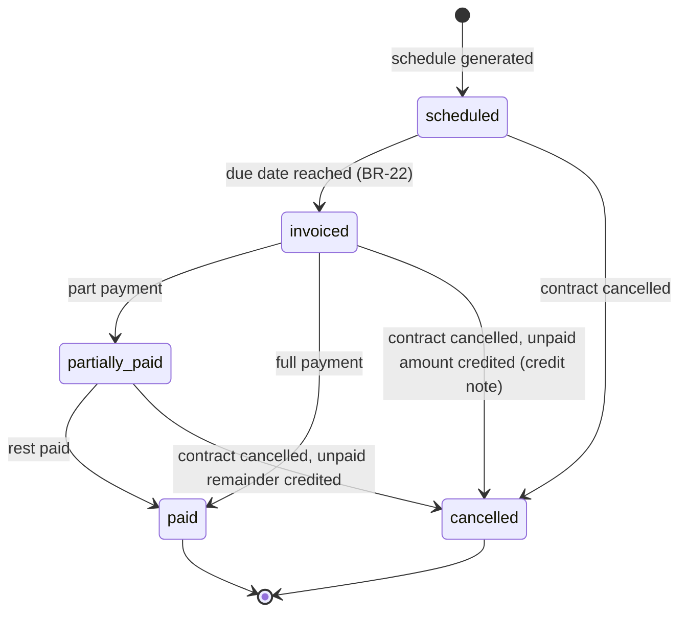

# Story intake — 04-accounting-link

> **Source:** manual entry (no tracker). Rules, user stories and acceptance criteria below are pasted
> verbatim from `docs/business-requirements.md` v0.2 — if they ever disagree, that document wins.

---

## Feature

- **Feature name (display):** Real estate installments & collections
- **Feature slug (folder under `plans/`):** `installments`

## Tracker (metadata only)

- **Tracker type:** `none`
- **Work item id:** `04-accounting-link`

---

## Title

Accounting link: invoices, payment state, closing and cancellation money

---

## Description

Connect schedule lines to Odoo Accounting. Each line becomes one customer invoice — at confirmation
for anything already due, otherwise on its due date through the nightly job — posted to the customer
advances account (maintenance deposit to its liability account) with no taxes. A line's paid / partly
paid / unpaid status and the contract's totals are read from accounting, never typed.

This story also creates the nightly job with its invoicing and closing steps (Story 05 adds the
late-fee steps), and finishes cancellation: retention and refundable amount from real payments, then
credit notes for whatever is invoiced but unpaid.

---

## Acceptance criteria

### User stories

**US-03 — Invoice each line when it falls due**
*As an **accountant**, I want each schedule line invoiced on its due date without manual work, so that
receivables in accounting always match the contracts.*

**US-12 — Close the contract when everything is paid**
*As an **accountant**, I want a contract to close itself once fully paid, so that open contracts mean
open money.*

**US-09 — Cancel a contract**
*As a **sales manager**, I want to cancel a contract with the retention computed, so that the unit
can be resold and the accountant knows what to refund.*

**US-10 — Confirm a contract**
*As a **sales manager**, I want to approve each contract before it becomes binding, so that no deal is
committed without a check.*

**US-11 — Record delivery of the unit**
*As a **sales manager**, I want to record the handover date, so that the maintenance deposit falls
due and the unit shows as delivered.*

### Business rules

| ID | Rule |
|---|---|
| BR-12 | A delivered contract **closes automatically**, on the next nightly run, when every line on it — down payment, installments, maintenance deposit and any billed late fees — is fully paid, and no accrued late fee is left unbilled. v1 has no late-fee waiver (Chapter 7). |
| BR-18 | The **maintenance deposit** = contract price × maintenance %, rounded to whole EGP (half up). It is a separate schedule line and is **not** part of the contract price. If due at signing, it is due on the contract date; if due at delivery, it has no date until the contract is delivered, then it is due on the delivery date. |
| BR-21 | On confirmation, **every line due on or before the confirmation date is invoiced at once** — the down payment, a maintenance deposit due at signing, and any installment already due. |
| BR-22 | Each later line is invoiced automatically on its due date. A company setting allows invoicing N days earlier (default 0). **No line is invoiced before its contract is confirmed.** One invoice per schedule line — Odoo's multi-due-date payment terms are not used, because late fees, partial payments and BR-25 all work per line. |
| BR-23 | The maintenance deposit is invoiced on its due date. It is money held for the compound's upkeep, not revenue, so it posts to a **deposit liability account**, never to sales revenue. |
| BR-24 | Whether a line is paid, partly paid or unpaid is **read from its invoice in accounting**; nobody types "paid". Amounts come from the invoice's amount due (`amount_residual`); an invoice shown as *In payment* counts as paid. Bank and cash journals use an **outstanding receipts account**, so a registered payment reduces the amount due at once instead of waiting for bank reconciliation (demo data and tests configure this). A payment counts from its own accounting date. |
| BR-25 | Each line invoices exactly once, however many times the invoicing job runs. |
| BR-26 | A line's **effective due date** is the later of its scheduled due date and its invoice date, so nothing is late for time before the contract was confirmed. **Days past due** = today − effective due date. A line is **overdue** when it is not fully paid and today is **after** effective due date + **grace period** (7 days). |
| BR-43 | Down payment and installment invoices post to a configurable **customer advances** account, before and after delivery. v1 records no sales revenue; moving advances to revenue at delivery is v1.1 (Chapter 7). |
| BR-44 | Schedule-line invoices carry **no taxes** in v1, even if the company has default sales taxes. Residential unit sales are VAT-exempt; the treatment of commercial units must be confirmed with a tax advisor. |
| BR-33 | On cancelling a confirmed contract, the system computes the **retention** — 15% (a company setting) of what the customer has paid **against the down payment and installments**, rounded to whole EGP — from actual payments, **before** any credit note is created. **Refundable amount** = that paid amount − retention, plus any paid maintenance deposit in full; paid late fees are not refunded. Both are recorded on the contract. Issuing the refund is the accountant's manual step. |
| BR-34 | On cancellation, whatever has been invoiced but not paid is credited: a fully unpaid invoice in full, a partly paid one by a credit note for exactly its unpaid remainder, reconciled with it. Lines not yet invoiced are cancelled, and the unit becomes available again. After cancellation every line shows **cancelled** — set by the module, not read from accounting, where a credited invoice shows as paid. |

### Acceptance criteria (from the business document)

- **AC-03.1** When a contract is confirmed, then every line already due is invoiced immediately — the
  down payment, and for Example C (Chapter 6) also the maintenance deposit due at signing.
- **AC-03.2** Given an installment due today, when the invoicing job runs, then one customer invoice
  is posted for it. When the job runs again the same day, no second invoice is created.
- **AC-03.3** Given a maintenance deposit falls due, its invoice posts to the maintenance deposit
  liability account, not to sales revenue.
- **AC-03.4** Given a 241,313 invoice and a bank journal with an outstanding receipts account, when a
  payment of 141,313 is registered, the line shows **partly paid** with 100,000 outstanding; when the
  rest is paid, it shows **paid** (also while accounting shows the invoice *In payment*).
- **AC-03.5** The contract shows total paid and total outstanding, both computed from accounting.
- **AC-03.6** Given the company has a default sales tax, schedule-line invoices still carry no tax.
- **AC-03.7** Down payment and installment invoices post to the customer advances account, not to
  sales revenue.
- **AC-12.1** Given a delivered contract whose last unpaid line has been paid, when the nightly job
  runs, the contract becomes closed.
- **AC-12.2** A confirmed (not delivered) contract that is fully paid stays confirmed.
- **AC-09.3** Given the customer paid 858,000 + 4 × 241,313 = 1,823,252, when the manager cancels,
  retention is **273,488** and refundable is **1,549,764**, both recorded on the contract and
  unchanged after the credit notes are created.
- **AC-09.4** After cancellation, invoiced-but-unpaid amounts are credited (including the unpaid
  remainder of a partly paid invoice), future lines are cancelled, every line shows **cancelled**, and
  the unit is available.
- **AC-10.3** On confirmation the unit shows **sold** and every line already due is invoiced (BR-21).
  *This story:* every line already due is invoiced.
- **AC-11.2** On delivery, a maintenance deposit "due at delivery" gets the delivery date as its due
  date and is invoiced.
- **AC-11.3** Installments not yet due stay scheduled as before.

### Reference data (test fixtures)

#### 5.3 Schedule line states

A line is a down payment, an installment, or the maintenance deposit. Payment states are read from
accounting (BR-24); `overdue` is computed (BR-26).

An invoiced or partly paid line is additionally **overdue** while unpaid after its effective due
date + grace (BR-26).

#### 5.5 Nightly job, in order

1. Invoice every scheduled line of a confirmed contract whose due date (minus lead days) has arrived
   — once per line (BR-25).
2. For every overdue line, and every line paid since the last run, recompute its accrued late fee
   from its payment history and store it (BR-27–BR-29).
3. Flag contracts with a line more than 60 days past due as at risk; clear the flag when no such line
   remains (BR-31).
4. Close delivered contracts whose lines are all paid and have no unbilled late fee (BR-12).

**A — Standard plan.** Unit `HNC-B07-0302`, 3-bedroom, 165 m² × 52,000 = **8,580,000**. Plan
`NH-STD-8Q`, contract date 10 Jan 2027.

| Line | Amount | Due |
|---|---|---|
| Down payment (10%) | 858,000 | 10 Jan 2027 |
| Installments 1–31 | 241,313 each | quarterly, 10 Apr 2027 → 10 Oct 2034 |
| Installment 32 | **241,297** | 10 Jan 2035 |
| **Total of price** | **8,580,000** | |
| Maintenance deposit (8%) | 686,400 | on delivery date |

Exact installment = 7,722,000 ÷ 32 = 241,312.50 → rounded half up to 241,313; 31 × 241,313 =
7,480,703; last = 7,722,000 − 7,480,703 = 241,297.

**C — Month-end dates.** Office `CBP-A02-0105`, 60 m² × 61,000 = **3,660,000**, plan `NH-BIZ-5M`,
contract date **31 Jan 2027**: down payment 732,000 and maintenance deposit 366,000 (at signing) due
31 Jan 2027; 60 installments of 48,800; first four due **28 Feb, 31 Mar, 30 Apr, 31 May 2027**.

**E — Cancellation.** Example A's customer has paid the down payment and four installments:
858,000 + 4 × 241,313 = **1,823,252**. Retention 15% = **273,488**; refundable = **1,549,764**.
The maintenance deposit (due at delivery) was never paid, so nothing is added to the refund.

---

## Attachments

None. Everything the planner needs is pasted above.

---

## Dependencies

- **Blocked by / related ids:** 03-schedule-generator
- **Depends on code areas or other stories:** Story 03 (schedule lines exist), Story 02 (states, groups).

## Extra notes (optional)

Odoo 19 behaviour to design around (BR-24): without an outstanding receipts account on the journal,
registering a payment creates no journal entry and the invoice's amount due does not drop until bank
reconciliation. Demo data and every accounting test configure the outstanding receipts account.

Record an ADR here: `l10n_eg` is not a hard dependency; the module works with any chart of accounts
and the README recommends `l10n_eg` for Egyptian companies.

## Technical hints (optional)

Names below are hints. Each one is verified in `odoo-src/` before the plan cites it (no invented symbols).

- Tests inherit Odoo's `AccountTestInvoicingCommon` (verify its location and setup API in `odoo-src/odoo/addons/account/tests/`), not hand-built charts of accounts.
- One service product per charge type in `data/` (down payment, installment, maintenance deposit, late fee).
- Invoice due date = the line's effective due date (BR-26); `invoice_date` set by the job.
- Read `amount_residual` and `payment_state` (`in_payment` counts as paid); never write to them.
- Idempotency (BR-25): a link from line to invoice, checked before creating.
- Partial credit (BR-34): a manual credit note for exactly the unpaid remainder, reconciled with the invoice; the standard reversal wizard credits the full amount.
- Closing runs in the nightly job (AC-12.1), not on payment events.

## Out of scope

- Late fees and overdue flags (Story 05).
- Revenue recognition at delivery (v1.1 — Chapter 7).
- Paying out the refund (the accountant's manual step, BR-33).
- Taxes and ETA e-invoicing (Chapter 7).
