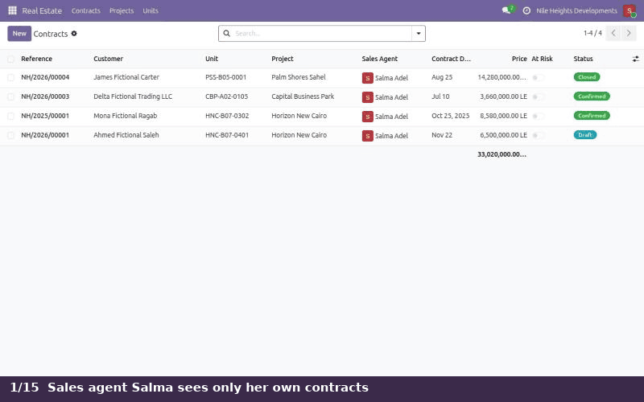
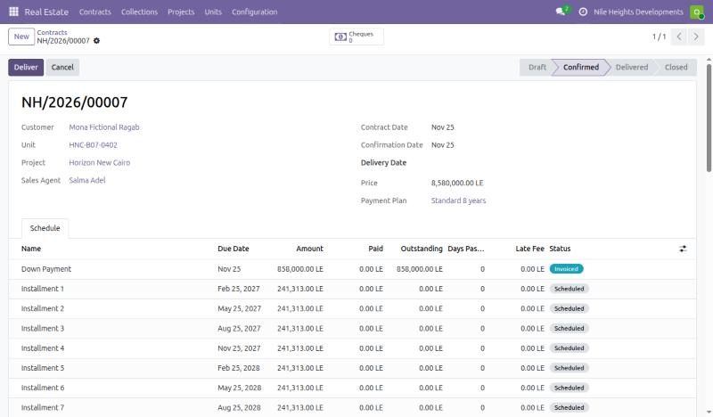
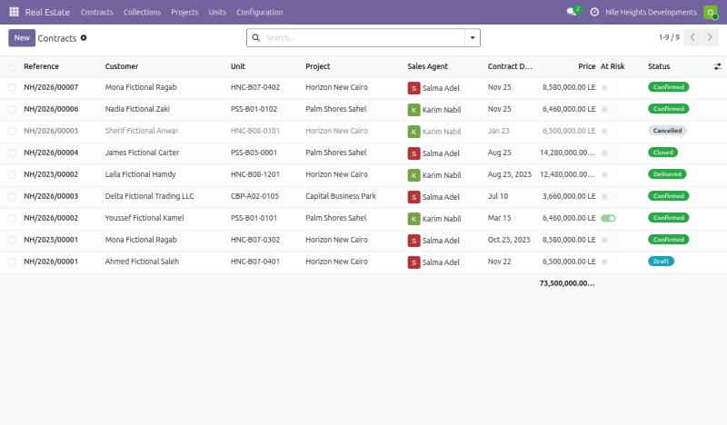
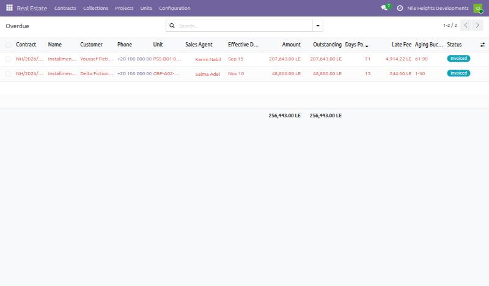
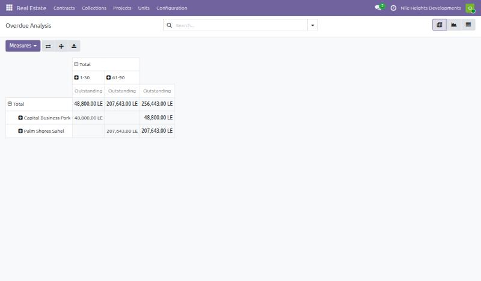
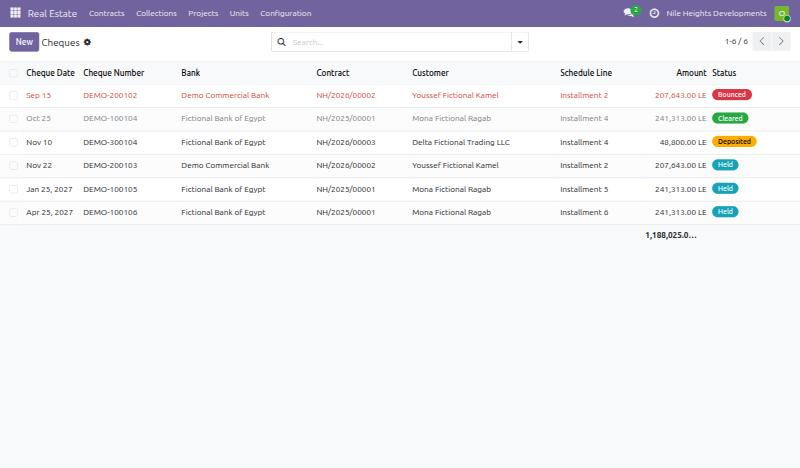
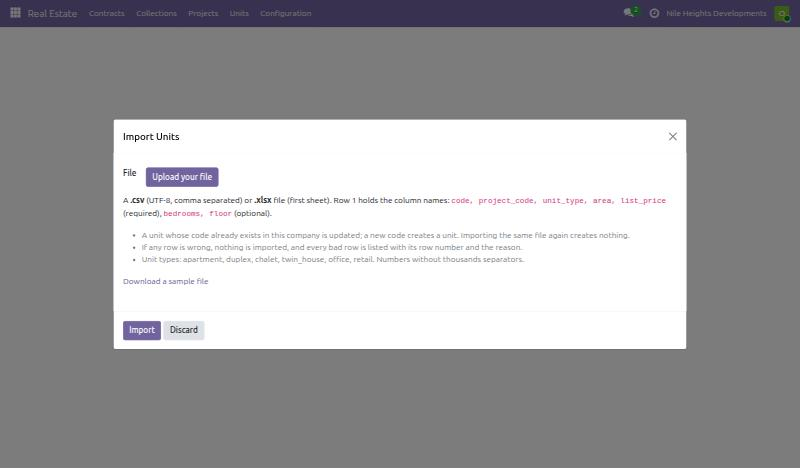
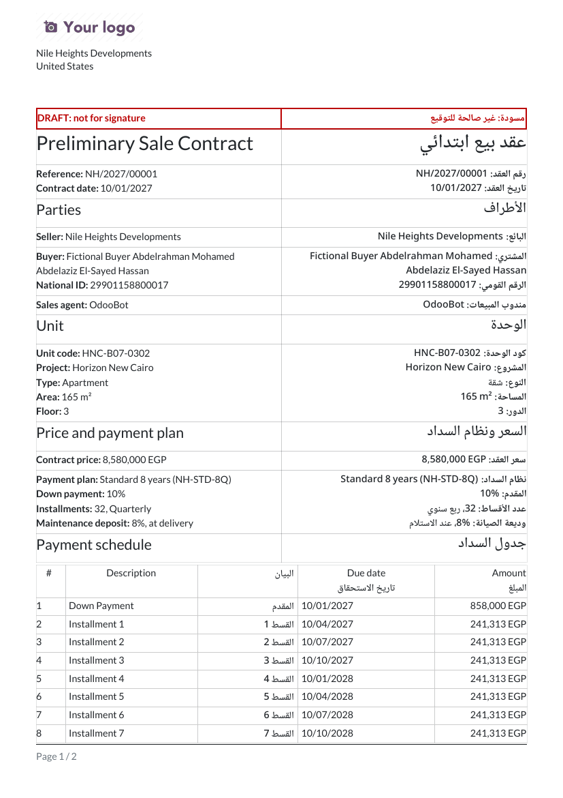
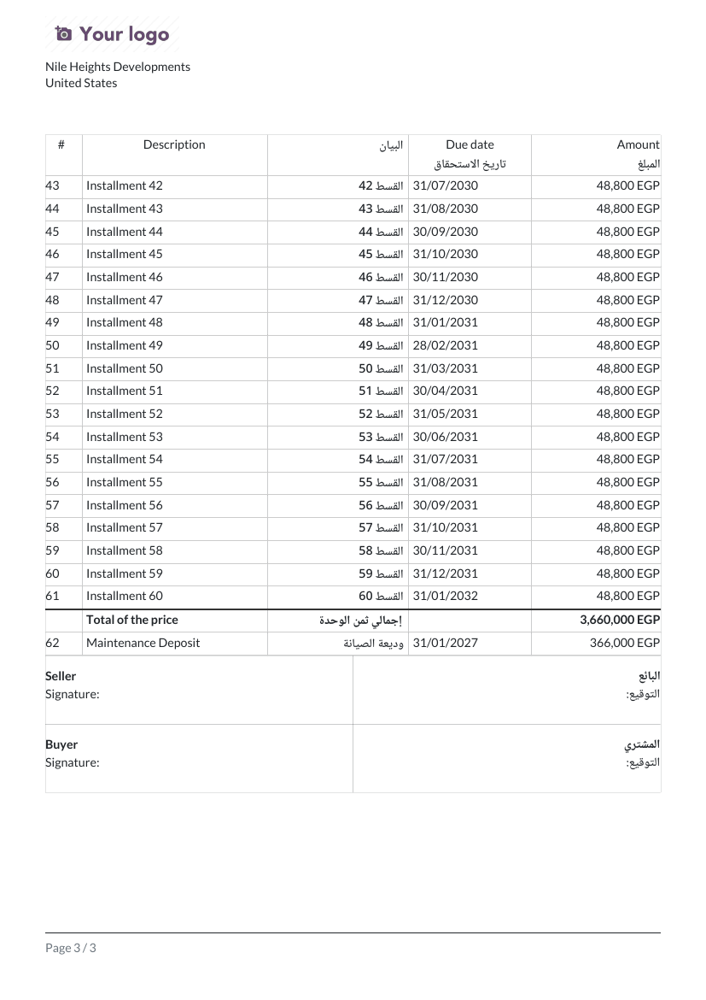

# Real Estate Installments (Egypt) — Odoo 19

[](https://github.com/MAbdallaDev/odoo-real-estate-eg/actions/workflows/ci.yml)
[](https://www.odoo.com/documentation/19.0/)
[](LICENSE)
[](addons/real_estate_eg/tests/)
[](#quality-gates)

`real_estate_eg` is an Odoo 19 Community addon for Egyptian real-estate developers who sell
units on installment plans and then have to collect them.

In Egypt a unit is rarely paid in cash: the buyer pays a down payment, then years of
quarterly or monthly installments, a maintenance deposit at delivery, and late fees on
anything overdue. Odoo has no concept of any of this, so every implementation partner
rebuilds it. This module does it once, on top of standard Odoo accounting.

> **Status: v1.0.0** — all ten stories shipped, each through a reviewed pull request. See the
> [Roadmap](#roadmap) and the [changelog](CHANGELOG.md).



*A 60-second click-through of the demo data: a sales agent creates a contract and its
schedule, the manager confirms it, then the collections screens, cheques, units, the import
and the bilingual PDF. Built from real screenshots of `make demo`, one caption per screen.*

## What v1 does

- **Contracts** for project units, moving through draft → confirmed → delivered → closed,
  or cancelled with the developer's retention computed from real payments.
- **Payment schedules** generated from plan templates: down payment, N installments
  (monthly or quarterly), whole pounds with the rounding difference on the last line, and
  the maintenance deposit as its own scheduled amount.
- **Invoicing through standard accounting:** each line becomes a customer invoice on its due
  date, booked to customer advances; paid and outstanding amounts are read from real
  payments.
- **Collections:** overdue lines flagged nightly, late fees computed from payment history
  (re-running the job never double-charges), an at-risk flag, due-this-month, overdue and
  aging views.
- **Post-dated cheques** (شيكات آجلة): each cheque the buyer hands over is tracked on its
  schedule line, held → deposited → cleared or bounced, with a "to deposit" list. Status
  only: accounting alone decides what is paid.
- **Security:** sales agents see only their own contracts; collections officers and
  accountants read everything; multi-company aware.
- **Bilingual contract PDF**, Arabic and English side by side.
- **Unit import** from CSV or Excel: matched by unit code, so it can be re-run without
  duplicates; all or nothing, with every bad row reported by row number and reason.
- **Demo data:** an invented developer, *Nile Heights Developments*, with fifteen months of
  history.

The full specification — business rules `BR-xx`, user stories `US-xx` with acceptance
criteria, and the invented developer whose numbers become the demo data and test
fixtures — is in [`docs/business-requirements.md`](docs/business-requirements.md).

## Screenshots

| | |
|---|---|
|  |  |
| A confirmed contract: the down payment invoiced at once, 32 quarterly installments | The manager's view: contracts in every state, one at risk |
|  |  |
| Overdue lines: days past due, late fee, aging bucket | Overdue amounts by project and aging bucket |
|  |  |
| Post-dated cheques: held, deposited, cleared, bounced | Unit import from CSV or `.xlsx` |
|  |  |
| The contract PDF, Arabic and English side by side | The schedule table and signatures |

## Try it with demo data

After the [quick start](#quick-start):

```bash
make demo                    # fresh database re_demo with Nile Heights' demo data
make run DB=re_demo          # http://localhost:8019
```

Log in as one of the five (fictional) people of Chapter 6. Every demo password is `demo`:
these accounts are for a local demo database only.

| Login | Person | Role | Try |
|---|---|---|---|
| `salma` | Salma Adel | Sales agent | Create a contract and generate its schedule; she sees only her own contracts |
| `karim` | Karim Nabil | Sales agent | The other agent: none of Salma's contracts |
| `omar` | Omar Fathy | Sales manager | Confirm, deliver or cancel a contract; **Configuration → Import Units** |
| `hoda` | Hoda Samir | Collections officer | **Collections**: due this month, overdue, aging, at risk, cheques to deposit |
| `tarek` | Tarek Mansour | Accountant | Register a payment on an invoice and watch the line turn paid |

The demo company has contracts in every state, overdue and at-risk lines, billed late fees
and cheques in every state, dated back from the day it is installed. Tests never use it.

## Requirements

- Linux, or Windows with **WSL2 (Ubuntu)** — every command below works unchanged there
- Python **3.12** (Odoo 19 supports 3.10+) with `python3-venv` and `python3-dev`
- PostgreSQL **16**, plus build headers for Odoo's requirements:
  `build-essential libpq-dev libldap2-dev libsasl2-dev`
- **wkhtmltopdf 0.12.6.1 with patched Qt** (for PDF reports)
- **An Arabic font: Noto Naskh Arabic** (for the Arabic / English contract PDF). On Debian /
  Ubuntu it is in `fonts-noto-core`: `sudo apt install fonts-noto-core`, then
  `fc-list | grep "Noto Naskh Arabic"` must list it. Without it wkhtmltopdf prints the Arabic
  letters apart. The CI image installs it too ([`docker/Dockerfile.ci`](docker/Dockerfile.ci)).
- Docker (only to reproduce CI locally)

## Quick start

```bash
# 1. A Postgres role for Odoo: not a superuser, allowed to create databases
sudo -u postgres createuser --createdb --pwprompt odoo19_real_estate

# 2. Store its password in ~/.pgpass so neither Odoo nor dropdb asks for it
#    (read -s keeps the password off the screen and out of shell history)
read -rsp 'Password: ' P; echo; printf 'localhost:5432:*:odoo19_real_estate:%s\n' "$P" >> ~/.pgpass; unset P
chmod 600 ~/.pgpass

# 3. Clone, then build everything: Odoo 19 source, venv, requirements, odoo.conf, git hook
git clone https://github.com/MAbdallaDev/odoo-real-estate-eg.git
cd odoo-real-estate-eg
make setup          # then set admin_passwd in odoo.conf

# 4. Run
make run            # http://localhost:8019 → Apps → "Real Estate Installments (Egypt)"
```

`make setup` clones Odoo 19 Community into `odoo-src/` and creates `venv/`; both are
gitignored and rebuilt, never copied. `odoo.conf` is created from
[`odoo.conf.example`](odoo.conf.example) and is gitignored too.

### Accounting setup

Before the first contract is confirmed:

1. **Chart of accounts.** For an Egyptian company, install Odoo's Egyptian localisation
   (`l10n_eg`). It is recommended, not required: the module works with any chart
   ([why](docs/design-notes/04-accounting-link.md#adr-l10n_eg-is-not-a-dependency)).
2. **Two liability accounts** — customer advances and maintenance deposits — picked in
   *Settings → Real Estate*. Confirmation is refused until both are set.
3. **Outstanding Receipts** on the bank journal's incoming payment method. Without it a
   registered payment has no journal entry, and no line ever shows paid.
4. **A late fees income account** (e.g. *Other Income*) in *Settings → Real Estate →
   Collections*, next to the late fee rate (1 % a month), cap (10 %), grace period (7 days)
   and at-risk days (60). These are illustrative values: 12 % a year is above the Civil Code
   cap, so set them with your lawyer
   ([why](docs/design-notes/05-late-fees.md#open-questions)).

## Daily commands

| Command | What it does |
|---|---|
| `make run` | Odoo on database `re_dev`, port 8019 (`ARGS="..."` passes extra options) |
| `make demo` | Fresh `re_demo` database with the demo data; fails on any warning in the log |
| `make test` | Fresh `re_test` database, installs the module, runs its tests, checks the log |
| `make coverage` | The same tests under `coverage.py`, then the coverage report |
| `make test-ci` | The same test run inside Docker, exactly as CI runs it |
| `make lint` | Every pre-commit check on all files |
| `make shell` | Odoo Python shell on `re_dev` |
| `make help` | List the targets |

## Quality gates

- **Tests** — 107 tests, all run as real agent, manager, collections or accountant users,
  never as admin, and never relying on demo data. `make test` fails if a test fails, if the
  log contains any `WARNING`, `ERROR` or `CRITICAL` line, or if no test of this module ran
  at all ([`scripts/check_odoo_log.sh`](scripts/check_odoo_log.sh)).
- **Coverage** — 97 % of the module's 990 statements (`make coverage`; tests, the demo
  loader and the manifest are not counted).
- **Traceability** — every user story `US-01`…`US-13` has at least one test naming it; a
  pre-commit hook ([`scripts/check_us_tests.sh`](scripts/check_us_tests.sh)) fails otherwise.
- **Lint** — the OCA pre-commit stack, pinned to the versions OCA uses for Odoo 19: `ruff`,
  `pylint-odoo` (OCA's mandatory checks), `oca-checks-odoo-module`,
  `oca-fix-manifest-website`, `prettier` with the XML plugin, and basic file checks. It runs
  on every commit.
- **CI** — GitHub Actions runs the lint and the tests (Postgres 16 + the official Odoo 19
  image, both pinned by digest) on every push and pull request. `main` changes only through
  pull requests with green CI.
- **Performance** — a one-million-line load test in a separate database
  ([`scripts/perf/`](scripts/perf/README.md), never in CI); the Overdue list's query plan before
  and after its index is in the
  [design note](docs/design-notes/07-collections-performance.md#performance-s071--s073).

## Design notes

One per story: what was built, why this way, the alternatives, the tests and the negative
checks that proved them.

| # | Note | In one line |
|---|---|---|
| 01 | [Environment and module skeleton](docs/design-notes/01-environment.md) | Odoo source + venv, the Makefile, OCA lint, CI in Docker, a clean-log rule |
| 02 | [Core models, views, states and access rights](docs/design-notes/02-core-models.md) | Projects, units, contracts; one live contract per unit enforced in the database |
| 03 | [Payment plans and the schedule generator](docs/design-notes/03-schedule-generator.md) | Whole-pound schedules that sum exactly to the price |
| 04 | [Accounting link](docs/design-notes/04-accounting-link.md) | Invoices per line, payment state from accounting, closing and cancellation money |
| 05 | [Overdue lines, late fees and the at-risk flag](docs/design-notes/05-late-fees.md) | Late fees from payment history, so the nightly job is idempotent |
| 06 | [Record rules](docs/design-notes/06-record-rules.md) | Agents see their own contracts; multi-company |
| 07 | [Collections screens and query performance](docs/design-notes/07-collections-performance.md) | The collections lists, and their query plans on one million lines |
| 08 | [Bilingual Arabic / English contract PDF](docs/design-notes/08-bilingual-pdf.md) | Arabic and English side by side in one QWeb report |
| 09 | [Post-dated cheques](docs/design-notes/09-post-dated-cheques.md) | A state machine in `write()`; cheque status is information only |
| 10 | [Ship v1.0.0](docs/design-notes/10-ship.md) | Unit import, demo data that replays history, the release checklist |

## Possible next

Deliberately left out of v1; each is described, with what it would touch, in
[Chapter 7](docs/business-requirements.md#7-beyond-v1) of the business requirements.

- **Revenue recognition at delivery** — planned for v1.1. v1 books every installment to
  customer advances and records no revenue (BR-43); moving advances to revenue at delivery
  needs an agreed accounting treatment.
- **ETA e-invoicing** through Odoo's `l10n_eg_edi_eta` (OAuth2 client-credentials token,
  signed documents, preproduction vs production environments); needs a registered taxpayer's
  credentials and a tax advisor on how unit sales are treated.
- **Post-dated cheque accounting** — journals for cheques under collection, entries on
  deposit and bounce.
- **Importing existing contracts** with their schedules and payment history.
- **Reservation amount**, **late-fee waiver**, **broker commissions**, **discounts and
  plan-based pricing**, **resale / assignment**, **developer-delay rights**.
- **Customer portal**, **online payment** (Fawry, Paymob, InstaPay), **multi-currency**.
- **A REST API** over contracts, schedules and payment state — a separate project.

## Roadmap

| # | Story | Status |
|---|---|---|
| 01 | Environment and module skeleton | done |
| 02 | Core models, views, states and access rights | done |
| 03 | Payment plan templates and the schedule generator | done |
| 04 | Accounting link: invoices, payment state, closing and cancellation money | done |
| 05 | Overdue lines, late fees and the at-risk flag | done |
| 06 | Record rules: agents see their own contracts; multi-company | done |
| 07 | Collections screens and query performance | done |
| 08 | Bilingual Arabic / English contract PDF | done |
| 09 | Post-dated cheques | done |
| 10 | Ship v1.0.0: unit import, demo data | done |

## How this is built

Each story has a written intake and plan in [`.squad/`](.squad/) whose Done Criteria
become the tests, one branch and one pull request per story, and a design note in
[`docs/design-notes/`](docs/design-notes/) explaining why it is built that way.

**Built with AI assistance.** Every story starts from a written spec and plan; an AI
coding assistant helps implement it, and every change is reviewed and merged by the
maintainer. Mistakes caught in review are logged in
[`docs/learning-log.md`](docs/learning-log.md), with the maintainer's own explanation of
each story.

## License

[LGPL-3](LICENSE), the same license as Odoo Community addons.
