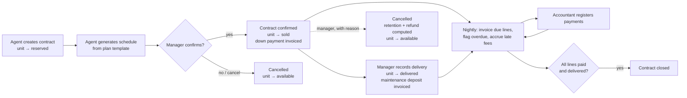
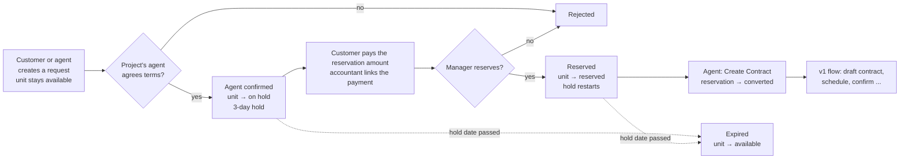
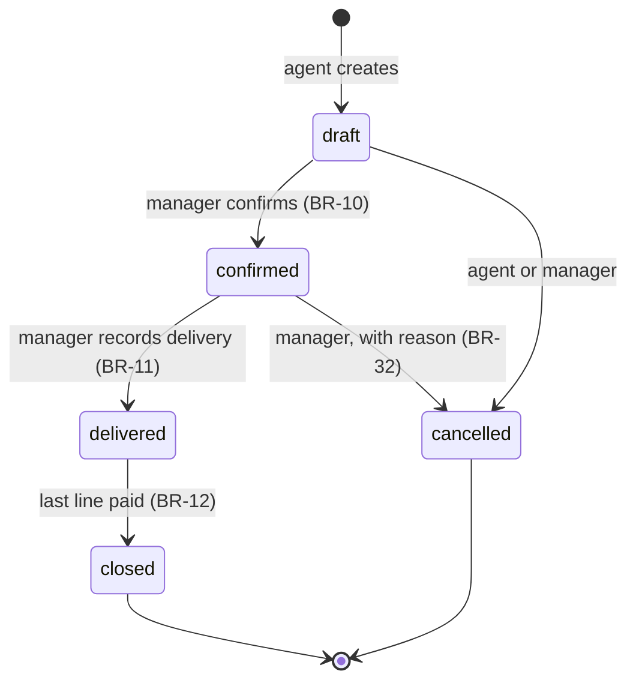
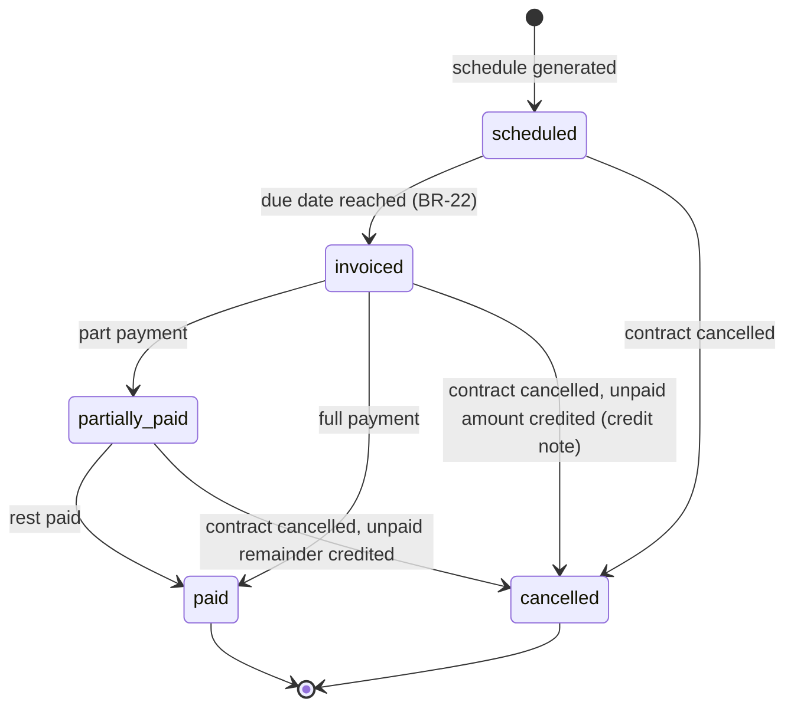
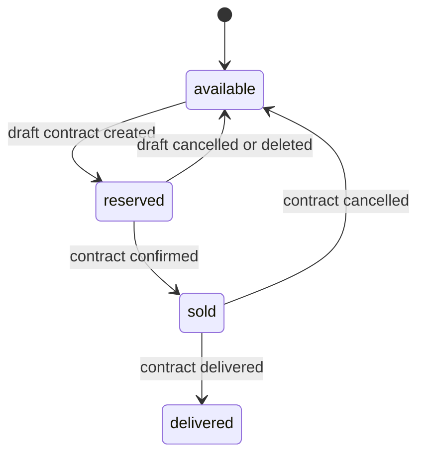
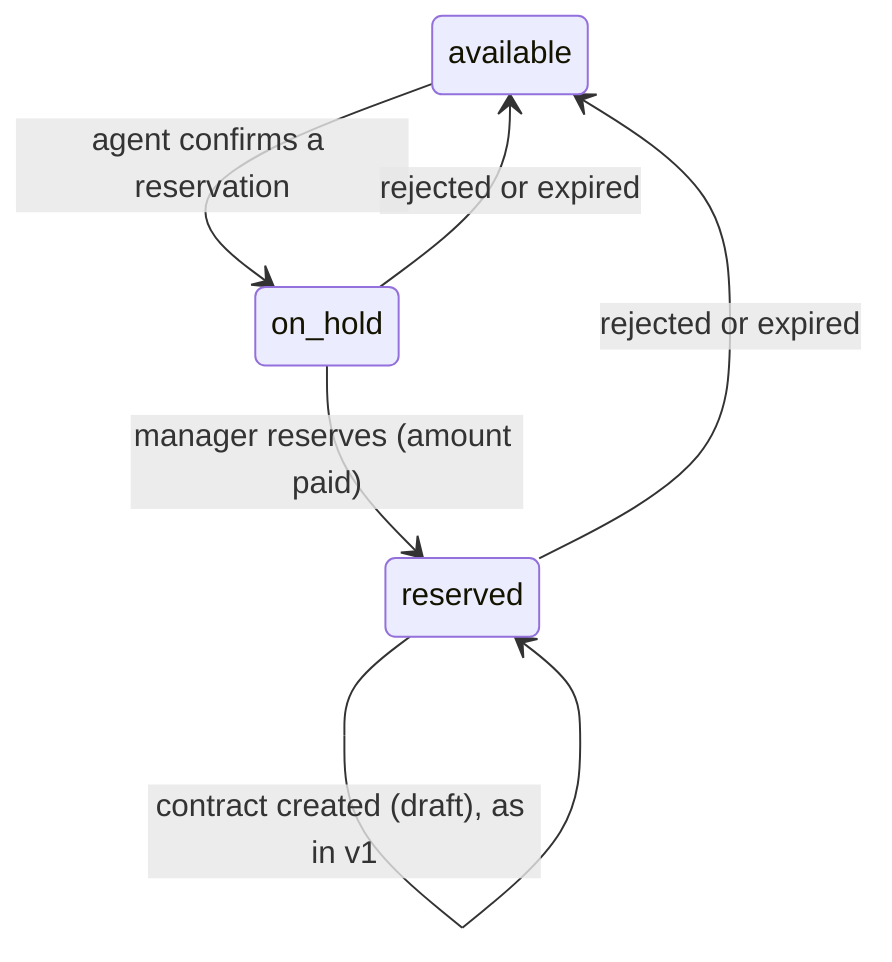
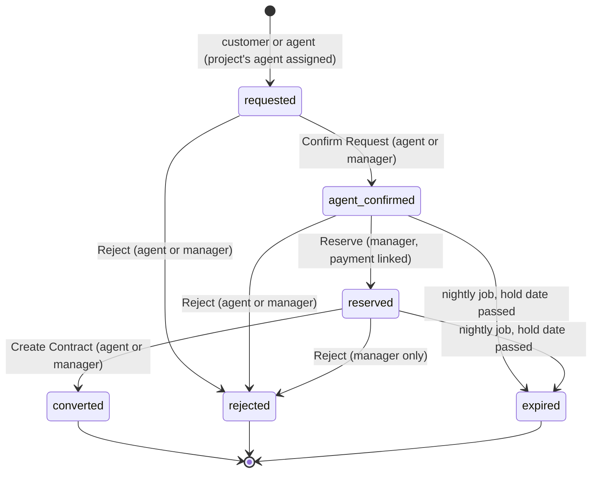

# Business Requirements — Real Estate Installments & Collections (Egypt)

| | |
|---|---|
| Module | `real_estate_eg` (Odoo 19 Community) |
| Status | **v0.2 — Chapter 8 answered (Checkpoint 1 passed); stories next (Checkpoint 2)** |
| Date | 2026-11-21 |
| Scope change | 2026-11-25: US-13 (post-dated cheques, Story 09) moved from stretch into v1. Cheque *accounting* stays beyond v1 (Chapter 7). |
| Scope change | 2026-11-28: **v1.1** adds reservations (US-14, BR-47–BR-54, Story 11), moved out of Chapter 7, as the base for the customer portal. |
| Scope change | 2026-11-28: **v1.1** adds the customer portal REST API (US-15, BR-55–BR-58, Story 12) in a separate addon, `real_estate_eg_portal`. The portal screens follow in Story 13. |
| Scope change | 2026-11-28: **v1.1** adds the customer portal pages (US-16, BR-59–BR-60, Story 13) in the same addon: OWL pages under `/my/real-estate/` that call the same API with the browser session. |
| Scope change | 2026-11-28: **v1.1** adds photos, floor plans, project descriptions, the plans each project is sold with and a unit page to the portal (US-17, BR-61–BR-63, Story 14), in the same addon. |
| Company in this document | **Nile Heights Developments** (نايل هايتس للتطوير العقاري) — invented. Every name, number and person here is fictional. |

**How to read this document.** Chapter 1 is the build contract: what v1 does, as user stories and
numbered business rules. Chapters 2–6 explain the business those stories come from. Chapter 7 is
everything we deliberately left out. Chapter 8 lists the business decisions still open — each with a
recommendation — and was answered before any code was written.

**Traceability.** Every rule is `BR-xx`, every story is `US-xx`. Each acceptance criterion becomes at
least one automated test, except those marked *(manual)*, which are checked by hand in the release
checklist. Each build story's intake quotes the IDs it covers: `BR → US → intake → plan → test`.

---

## Contents

1. [MVP (v1) — user stories and business rules](#1-mvp-v1--user-stories-and-business-rules)
2. [Domain primer — how an Egyptian developer sells a unit](#2-domain-primer--how-an-egyptian-developer-sells-a-unit)
3. [Glossary — Arabic / English](#3-glossary--arabic--english)
4. [Actors and roles](#4-actors-and-roles)
5. [Process flows and state machines](#5-process-flows-and-state-machines)
6. [Nile Heights Developments — the invented company](#6-nile-heights-developments--the-invented-company)
7. [Beyond v1](#7-beyond-v1)
8. [Open business questions](#8-open-business-questions)
9. [Sources](#9-sources)

---

## 1. MVP (v1) — user stories and business rules

### 1.1 Scope in one paragraph

v1 lets a developer sell a unit on an installment plan and then collect it. A sales agent creates a
contract for an available unit and generates its payment schedule from a plan template; a sales
manager confirms it. From then on the system invoices each line when it falls due, reads payment
status from accounting, flags overdue lines, accrues late fees every night, and shows collections
staff what to chase. The manager records delivery of the unit; the contract closes itself when
everything is paid. Contracts can be cancelled with the developer's retention computed. Agents see
only their own contracts. The contract prints as a bilingual Arabic/English PDF. Units can be
imported from a spreadsheet without creating duplicates. The post-dated cheques a buyer hands over
are recorded and their status tracked. Money received is booked as
customer advances; v1 records no sales revenue.

### 1.2 Business rules

#### Projects and units

| ID | Rule |
|---|---|
| BR-01 | A unit belongs to exactly one project. A unit's code is unique within its company. |
| BR-02 | A unit has a type, area (m²), floor and **list price** (EGP). Price per m² is shown, computed from list price ÷ area. |
| BR-03 | A unit's status — **available, reserved, sold, delivered** — is derived from its contract and is never typed by hand: no live contract → available; draft contract → reserved; confirmed → sold; delivered or closed → delivered. |
| BR-04 | A unit can have **at most one contract that is not cancelled**. Creating a second one fails, whoever tries and in whatever order (the double-sale case). It is enforced in the database, so it holds even when two users save at the same moment. |

#### Customers

| ID | Rule |
|---|---|
| BR-05 | The customer is a contact (person or company). Each individual buyer has a **nationality: Egyptian or foreign** (a field on the contact — the address country does not say it). An Egyptian individual must have a **national ID (الرقم القومي)** before the contract can be confirmed; a foreign individual must have a passport number instead. A company buyer has no identity check in v1. |
| BR-06 | A national ID is valid only if it has 14 digits, its first digit is 2 (born 1900–1999) or 3 (born 2000–2099), and digits 2–7 form a real date of birth (YYMMDD) that is not in the future. |
| BR-46 | A **national ID** or **passport number** belongs to **one contact only**, across all contacts and all companies, archived contacts included. Saving a contact with a number another contact already has is refused, and the message names that contact, so the agent can use the existing customer. *(Added 2026-11-23 from the Story 02 review.)* |

#### Contracts

| ID | Rule |
|---|---|
| BR-07 | A contract links one customer, one unit, one sales agent and one payment plan, and gets a reference from a sequence, e.g. `NH/2027/00042`. Its **contract date** is set on the draft and cannot be later than the day it is confirmed; if left empty, it becomes the confirmation date. |
| BR-08 | The **contract price is frozen** at the unit's list price when the contract is created. Changing the unit's list price afterwards does not change existing contracts. If the unit is changed on a draft contract, the price is taken again from the new unit. |
| BR-09 | Contract states: **draft → confirmed → delivered → closed**, plus **cancelled**. No other transitions exist. |
| BR-10 | **Only a sales manager can confirm** a contract. Confirmation requires: a generated schedule whose down payment plus installments equal the contract price exactly, and the customer identity in BR-05. |
| BR-11 | **Only a sales manager can mark a contract delivered**, and only from confirmed. The delivery date is recorded. Installments continue after delivery as scheduled. |
| BR-12 | A delivered contract **closes automatically**, on the next nightly run, when every line on it — down payment, installments, maintenance deposit and any billed late fees — is fully paid, and no accrued late fee is left unbilled. v1 has no late-fee waiver (Chapter 7). |
| BR-13 | A contract that is not draft cannot be deleted. |

#### Payment plans and the schedule

| ID | Rule |
|---|---|
| BR-14 | A **payment plan template** defines: down payment %, number of installments, frequency (monthly, quarterly, semi-annual, annual), months from contract date to the first installment, maintenance deposit %, and when the maintenance deposit is due (**at signing** or **at delivery**). |
| BR-15 | **Down payment** = contract price × down payment %, rounded to whole EGP (half up). Due on the contract date. |
| BR-16 | **Installments**: (contract price − down payment) ÷ number of installments, each rounded to whole EGP (half up). **The last installment absorbs the rounding difference**, so down payment + installments = contract price to the pound. |
| BR-17 | **Due dates** are always computed from the contract date — installment *k* is due *offset + (k−1) × step* months after it — never from the previous due date. A date past the end of a short month moves to that month's last day, without drift: a plan anchored on 31 January falls due on 28 Feb, 31 Mar, 30 Apr, 31 May. |
| BR-18 | The **maintenance deposit** = contract price × maintenance %, rounded to whole EGP (half up). It is a separate schedule line and is **not** part of the contract price. If due at signing, it is due on the contract date; if due at delivery, it has no date until the contract is delivered, then it is due on the delivery date. |
| BR-19 | The schedule can be regenerated only while the contract is draft. Once confirmed, amounts and dates are locked. |
| BR-20 | A plan with 0 installments and 100% down payment is valid (a cash sale). |
| BR-45 | All money arithmetic rounds **half up** with exact decimal arithmetic (`Decimal`, or Odoo's `float_round`, which corrects binary-float error) — never plain `float`. Several test values sit exactly on a rounding tie (e.g. 3,619.695). |

#### Invoicing and payment

| ID | Rule |
|---|---|
| BR-21 | On confirmation, **every line due on or before the confirmation date is invoiced at once** — the down payment, a maintenance deposit due at signing, and any installment already due. |
| BR-22 | Each later line is invoiced automatically on its due date. A company setting allows invoicing N days earlier (default 0). **No line is invoiced before its contract is confirmed.** One invoice per schedule line — Odoo's multi-due-date payment terms are not used, because late fees, partial payments and BR-25 all work per line. |
| BR-23 | The maintenance deposit is invoiced on its due date. It is money held for the compound's upkeep, not revenue, so it posts to a **deposit liability account**, never to sales revenue. |
| BR-24 | Whether a line is paid, partly paid or unpaid is **read from its invoice in accounting**; nobody types "paid". Amounts come from the invoice's amount due (`amount_residual`); an invoice shown as *In payment* counts as paid. Bank and cash journals use an **outstanding receipts account**, so a registered payment reduces the amount due at once instead of waiting for bank reconciliation (demo data and tests configure this). A payment counts from its own accounting date. |
| BR-25 | Each line invoices exactly once, however many times the invoicing job runs. |
| BR-43 | Down payment and installment invoices post to a configurable **customer advances** account, before and after delivery. v1 records no sales revenue; moving advances to revenue at delivery is v1.1 (Chapter 7). |
| BR-44 | Schedule-line invoices carry **no taxes** in v1, even if the company has default sales taxes. Residential unit sales are VAT-exempt; the treatment of commercial units must be confirmed with a tax advisor. |

#### Overdue lines and late fees

| ID | Rule |
|---|---|
| BR-26 | A line's **effective due date** is the later of its scheduled due date and its invoice date, so nothing is late for time before the contract was confirmed. **Days past due** = today − effective due date. A line is **overdue** when it is not fully paid and today is **after** effective due date + **grace period** (7 days). |
| BR-27 | Once a line is overdue, a **late fee accrues for every day d from its effective due date up to, but not including, the day it is fully paid** — not from the end of the grace period — on the amount **unpaid on day d** (a payment counts from its own date), at 1% per month (1/30 of 1% per day; a company setting). Simple interest, never compounding. Every schedule line accrues — down payment, installments and maintenance deposit; **late-fee invoices never do**. Daily amounts are **not rounded day by day**: the total is computed from the unrounded daily amounts and rounded once (to piastres for display, to whole EGP when billed). Rounding each day would drift — 45 days on 241,313 gives 3,619.695 (shown 3,619.70) but 3,619.80 if each day were rounded to 80.44. |
| BR-28 | Total late fees on one line are **capped at 10%** of that line's amount. |
| BR-29 | A line's accrued late fee is **computed, not added up night by night**: from its effective due date, its payment history in accounting and the as-of date, then capped (BR-28). The nightly job stores the result. Running it twice, skipping a night, or entering a payment late with an earlier date all give the same answer as one correct computation. |
| BR-30 | Late fees are billed deliberately: a collections officer or sales manager bills a contract's unbilled fees in one invoice. Each line's unbilled fee = accrued − already billed, both kept unrounded; the invoice total is rounded **once** to whole EGP. The system never bills them on its own. |
| BR-31 | A contract with any line more than **60 days past due** is flagged **at risk of cancellation**. The system never cancels a contract on its own. |

#### Cancellation

| ID | Rule |
|---|---|
| BR-32 | A draft contract can be cancelled by its agent with no consequences. A confirmed contract can be cancelled **only by a manager, with a written reason**. A delivered or closed contract cannot be cancelled in v1. |
| BR-33 | On cancelling a confirmed contract, the system computes the **retention** — 15% (a company setting) of what the customer has paid **against the down payment and installments**, rounded to whole EGP — from actual payments, **before** any credit note is created. **Refundable amount** = that paid amount − retention, plus any paid maintenance deposit in full; paid late fees are not refunded. Both are recorded on the contract. Issuing the refund is the accountant's manual step. |
| BR-34 | On cancellation, whatever has been invoiced but not paid is credited: a fully unpaid invoice in full, a partly paid one by a credit note for exactly its unpaid remainder, reconciled with it. Lines not yet invoiced are cancelled, and the unit becomes available again. After cancellation every line shows **cancelled** — set by the module, not read from accounting, where a credited invoice shows as paid. |

#### Visibility

| ID | Rule |
|---|---|
| BR-35 | A **sales agent** sees only contracts where they are the agent, and their schedules, and edits them only while draft. A **sales manager** sees and edits all contracts, bills late fees and records cheques. A **collections officer** reads all contracts and schedules, bills late fees and records cheques, but cannot change prices, plans or schedules; billing goes through the module's own action, so the officer needs no general invoicing rights. An **accountant** reads all contracts and schedules and edits none. Agents see the cheques on their own contracts. |
| BR-36 | Users only see data of the companies they are allowed in. |

#### Collections, documents and data

| ID | Rule |
|---|---|
| BR-37 | Overdue amounts are grouped in **aging buckets** by days past due (BR-26): 1–30, 31–60, 61–90, over 90. Only overdue lines appear, so the first bucket holds days 8–30 in practice. |
| BR-38 | The contract prints as one PDF with **Arabic and English side by side**: parties, unit, price, plan, and the full schedule table. |
| BR-39 | Importing **units** from a spreadsheet is **repeatable**: importing the same file again updates the existing units, matched by unit code, and creates no duplicates. A file is imported **all or nothing**: if any row is wrong, nothing is imported and every bad row is reported with its row number and reason. Importing existing contracts is outside v1 (Chapter 7). |

#### Post-dated cheques

| ID | Rule |
|---|---|
| BR-40 | A **post-dated cheque** is its own record, linked to one schedule line: cheque number, bank, cheque date, amount and status. A line can have several cheques over time, because a bounced cheque is replaced, so the history is kept. |
| BR-41 | Cheque states: **held → deposited → cleared** or **bounced**. No other transitions. A bounced cheque can be replaced by a new held cheque on the same line. |
| BR-42 | Cheque status is **information only**. It never changes whether a line is paid, overdue or accruing late fees — BR-24 alone decides that. v1 creates no accounting entries for cheques. |

#### Reservations (v1.1)

| ID | Rule |
|---|---|
| BR-47 | A **reservation** (حجز) is its own record, before any contract: customer, unit, the project's agent, reservation amount, expiry date and status, with a reference from a sequence, e.g. `RES/2027/00001`. It starts as a customer's **request**; staff may also enter one for a walk-in or phone customer. |
| BR-48 | Reservation states: **requested → agent confirmed → reserved → converted**. A requested or agent-confirmed reservation can be **rejected**; a reserved one too, by a manager only. An agent-confirmed or reserved one **expires** (BR-53). No other transitions. Rejected, expired and converted are final. |
| BR-49 | A request can be made only for an **available** unit. Several requests may wait on one unit, but a unit has **at most one held reservation** (agent confirmed or reserved) at a time, enforced in the database. A unit with a contract that is not cancelled cannot be held. |
| BR-50 | Unit status (BR-03) in v1.1: a contract that is not cancelled decides it exactly as in v1. Without one, a unit with an agent-confirmed reservation is **on hold**, with a reserved one is **reserved**, otherwise **available**. An on-hold unit is offered to no other customer. |
| BR-51 | Each project has **one sales agent**. A request goes to that agent, who gets an activity. A project with no agent leaves the request unassigned, for the sales managers. An agent sees only the reservations assigned to them. The agent (or a manager) confirms the request after agreeing terms with the customer. |
| BR-52 | The **reservation amount** (جدية الحجز) defaults to the project's fixed amount and can be changed until the reservation is reserved. A manager moves it to **reserved** only once a posted **customer payment** from the same customer, of at least that amount, is linked to it by an accountant. One payment secures one reservation. The payment is an ordinary Odoo payment left as the customer's credit; the accountant later reconciles it with the down-payment invoice, so the down payment is paid in two parts. **The schedule is not changed** (BR-14–BR-20 hold as they are). |
| BR-53 | A held reservation **expires** after a company-set number of days (**default 3**), counted from the agent's confirmation and counted again from the manager's. A manager can change the expiry date. The nightly job expires held reservations whose expiry date has passed, and the unit becomes available again. |
| BR-54 | From a **reserved** reservation, its agent or a manager creates the **contract**: a draft for the reservation's customer, unit and agent, after which the reservation is **converted** and the v1 contract cycle runs unchanged. While a unit is held, the only contract allowed on it is the one its reservation creates, so a held reservation never sits beside a contract. |

#### Customer portal API (v1.1)

Built in a separate addon, `real_estate_eg_portal`, so `real_estate_eg` works without it.

| ID | Rule |
|---|---|
| BR-55 | A **customer** uses the portal as an Odoo **portal user** linked to their contact. The API authenticates them with an Odoo **API key** sent as `Authorization: Bearer <key>`; the only other way in is the portal pages' browser session (BR-59). The API is for customers only: a staff user's key is refused. |
| BR-56 | A customer sees **only their own** data, and only reads it: reservations and contracts whose customer is their contact or its company, the schedule lines of those contracts, and units that are **available** or that they have an open reservation or a contract on. A unit held for another customer is hidden (BR-50). Staff-only fields (the agent's notes on a reservation, the contract's at-risk flag) stay hidden, and a customer cannot post on the staff chatter of their records. This is enforced by Odoo access rights and record rules for portal users, never by code running as superuser. |
| BR-57 | A customer **requests a reservation** of an available unit through the API. The request is theirs (their contact's company, if any, is the customer) and follows BR-47–BR-51 unchanged: state requested, assigned to the project's agent with an activity, the unit stays available. They may add a note and their nationality with a valid national ID (BR-06) or a passport number; these are kept **on the request** for the agent to check against the card and copy to the contact, and the portal never edits contacts. A customer has at most **one open reservation per unit** and at most **5 open reservations** (requested, agent confirmed or reserved). Creating the request is the only step done as superuser, because customers have no create right on reservations. |
| BR-58 | The API is JSON under `/api/v1/`. Lists are paginated (`page`, `limit` up to 100, default 20; the answer gives the total). Every error is `{"error": {"code", "message"}}` with its HTTP code: 400 bad parameter or body, 401 no or invalid key, 403 not a customer, 404 not found, 409 conflict (unit not available, duplicate, too many open requests), 422 invalid value, 500 server error, never a traceback. A record the customer may not read is **not found**, so the answer does not reveal that it exists. An OpenAPI 3 description is served at `/api/v1/openapi.json`. |
| BR-59 | The portal pages call the **same API** with the customer's **browser session** instead of a key. A request with an `Authorization` header is checked as in BR-55, exactly as before. Without one, the logged-in user's session is used; a request that **changes data** (POST) must also carry the page's **CSRF token** in the `X-CSRF-Token` header, else it is refused with **403** (`csrf_failed`) and nothing changes. No session and no key is **401**; a staff session is **403**, as a staff key. No API key is ever stored in the browser. |
| BR-60 | The customer's pages are Odoo **portal pages** under `/my/real-estate/`, linked from cards on the portal home page (`/my`): **available units** (filters, request form), **my reservations**, **my contracts** and **one contract** with its installment schedule. Each page is one OWL component that reads and writes only through the API, so the pages show exactly what the API allows (BR-56–BR-58). The reservation and contract cards show the customer's count and stay hidden at 0, as Odoo's own cards. A visitor who is not logged in is sent to the login page; a staff user is sent back to `/my`; another customer's contract is **not found**. |
| BR-61 | Staff (sales managers) add **photos** to a project and to a unit, in order (the first is the cover), and a **floor plan** image to a unit. A unit without photos shows its project's. A customer sees a unit's photos and floor plan only when they may see the unit (BR-56), and a project's photos always; anything else is **not found**. The API serves the images itself (`/api/v1/images/<id>`, `/api/v1/units/<id>/floor-plan`), with the same authentication as the rest of the API, and lists the projects that have an available unit with their cover and number of available units, for the portal's banners. |
| BR-62 | A project lists the **payment plans it is sold with** (plan templates, chosen by a manager). For a unit, the customer sees only those plans, each **worked out on the unit's list price** with the same rules as a contract's schedule signed today (BR-15–BR-18): down payment, number and amount of installments (the last one absorbing the rounding), how often, the first one's delay, the maintenance deposit and when it is due, and the total. Nothing is saved; the agent agrees the final plan with the customer. A plan that would give a line of 0 or less at that price is not shown. |
| BR-63 | Each unit has a **portal page** (`/my/real-estate/units/<id>`): photos, facts (type, area, bedrooms, floor, price per m², expected delivery), floor plan, the plans of BR-62, the project (location, delivery, description written by staff, cover) and the reservation amount, with the request form of BR-57 while the unit is available. The unit list shows each unit's cover photo and links to this page. A unit the customer may not see is **not found**. |

### 1.3 User stories

Format: *As a … I want … so that …*, then acceptance criteria in Given / When / Then. Numbers in
examples come from Chapter 6.

---

#### US-01 — Create a contract for an available unit
*As a **sales agent**, I want to create a contract for an available unit and a customer, so that the
unit is held for that customer while the deal is finalised.*
Rules: BR-01–BR-09, BR-13, BR-46

- **AC-01.1** Given unit `HNC-B07-0302` is available, when an agent creates a contract for it, then
  the contract is draft, gets a reference from the sequence, its price is 8,580,000 EGP, and the unit
  shows **reserved**.
- **AC-01.2** Given the unit's list price is then changed to 9,000,000, when the agent reopens the
  contract, then its price is still 8,580,000.
- **AC-01.3** Given a unit already has a non-cancelled contract, when anyone creates a second contract
  for it, then it is refused with a message giving the existing contract's reference only.
- **AC-01.4** Given a customer's national ID is `29901158800017` (born 15 Jan 1999), the system
  accepts it; given `19901158800017` (first digit 1), `29902308800017` (30 February) or
  `33001018800017` (born 1 Jan 2030, in the future), the system refuses it.
- **AC-01.5** Given a draft contract, when the agent deletes it, then it is deleted and the unit is
  available. Given a confirmed contract, deleting it is refused.
- **AC-01.6** Given a draft contract for `HNC-B07-0302` at 8,580,000, when the agent changes the unit
  to a 2-bedroom HNC unit, then the price becomes 6,500,000.

#### US-02 — Generate the payment schedule from a plan
*As a **sales agent**, I want to pick a plan template and generate the schedule, so that the customer
sees exactly what they will pay and when.*
Rules: BR-14–BR-20

- **AC-02.1** Given a contract at 8,580,000 on 10 Jan 2027 with plan `NH-STD-8Q`, when the agent
  generates the schedule, then there is a down payment of 858,000 due 10 Jan 2027, 31 installments of
  241,313 and a last installment of **241,297**, quarterly from 10 Apr 2027 to 10 Jan 2035, and a
  maintenance deposit of 686,400 with no due date (due at delivery).
- **AC-02.2** Given any price and plan, down payment + installments = the contract price exactly.
  Tested with 6,712,345 on `NH-STD-8Q`: down payment 671,235, 31 × 188,785, last **188,775**.
- **AC-02.3** Given plan `NH-BIZ-5M` on a contract dated 31 Jan 2027, the first four installments are
  due 28 Feb, 31 Mar, 30 Apr and 31 May 2027.
- **AC-02.4** Given plan `NH-CASH`, the schedule is one down payment of the full price and no
  installments.
- **AC-02.5** Given a draft contract with a schedule, when the agent regenerates it with another plan,
  then the old lines are replaced. Given a confirmed contract, regeneration is refused.

#### US-03 — Invoice each line when it falls due
*As an **accountant**, I want each schedule line invoiced on its due date without manual work, so that
receivables in accounting always match the contracts.*
Rules: BR-21–BR-25

- **AC-03.1** When a contract is confirmed, then every line already due is invoiced immediately — the
  down payment, and for Example C (Chapter 6) also the maintenance deposit due at signing.
- **AC-03.2** Given an installment due today, when the invoicing job runs, then one customer invoice
  is posted for it. When the job runs again the same day, no second invoice is created.
- **AC-03.3** Given a maintenance deposit falls due, its invoice posts to the maintenance deposit
  liability account, not to sales revenue.
- **AC-03.4** Given a 241,313 invoice and a bank journal with an outstanding receipts account, when a
  payment of 141,313 is registered, the line shows **partly paid** with 100,000 outstanding; when the
  rest is paid, it shows **paid** (also while accounting shows the invoice *In payment*).
- **AC-03.5** The contract shows total paid and total outstanding, both computed from accounting.
- **AC-03.6** Given the company has a default sales tax, schedule-line invoices still carry no tax.
- **AC-03.7** Down payment and installment invoices post to the customer advances account, not to
  sales revenue.

#### US-04 — See what to chase today
*As a **collections officer**, I want one screen of what is due this month and what is overdue, by
aging bucket, so that I know whom to call today.*
Rules: BR-26, BR-31, BR-37

- **AC-04.1** A "Due this month" list shows every unpaid line due in the current month, with customer,
  phone, unit, amount and agent.
- **AC-04.2** An "Overdue" list shows every overdue line with days past due and accrued late fee.
- **AC-04.3** A pivot shows overdue amounts by project × aging bucket (1–30, 31–60, 61–90, 90+).
- **AC-04.4** *(manual)* Contracts flagged at risk can be filtered in one click.

#### US-05 — Flag overdue lines and accrue late fees every night
*As a **collections officer**, I want overdue lines flagged and late fees accrued automatically, so
that penalties are applied the same way for every customer.*
Rules: BR-26–BR-31

- **AC-05.1** Given an installment of 241,313 due 10 Apr 2027 and unpaid, on 15 Apr and on 17 Apr
  (due date + 7) it is not overdue; on 18 Apr it is overdue.
- **AC-05.2** Given the same line is paid in full on 25 May 2027 (45 days after due date), its total
  accrued late fee is 3,619.695, shown as **3,619.70** → billed as **3,620** EGP.
- **AC-05.3** Given 141,313 is paid on 30 Apr and 100,000 on 25 May, the accrued fee is 20 days on
  241,313 plus 25 days on 100,000 = **2,442.09** → billed as **2,442**.
- **AC-05.4** Running the nightly job twice on the same day gives the same totals as running it once.
  Skipping a night and running the next day gives the same totals as running both nights. A payment
  entered late with an earlier date gives the fee it would have had if entered on time.
- **AC-05.5** A line's accrued fee never exceeds 10% of its amount.
- **AC-05.6** Given a line becomes 61 days past due, its contract is flagged at risk; the contract is
  not cancelled.
- **AC-05.7** When a collections officer or sales manager bills late fees on a contract, one invoice is created for all
  unbilled fees, its total rounded once; billing again immediately creates nothing.
- **AC-05.8** The fee in AC-05.2 is 3,619.70, not 3,619.80 — daily amounts are not rounded one by one.
- **AC-05.9** A late-fee invoice that is itself paid late accrues no late fee.
- **AC-05.10** Given a contract dated 10 Jan 2027 and confirmed on 30 Jan 2027, its down payment's
  effective due date is 30 Jan 2027; it accrues no fee for 10–29 Jan and is not overdue on 6 Feb.

#### US-06 — Agents see only their own contracts
*As a **sales manager**, I want each agent to see only their own contracts while I see all, so that
customer data and deals stay with the person responsible.*
Rules: BR-35, BR-36

- **AC-06.1** Given agent A owns contract X, when agent B opens the contracts list, X is not there,
  and opening X directly gives an access error.
- **AC-06.2** A manager sees contracts of every agent.
- **AC-06.3** A collections officer sees all contracts but cannot edit price, plan or schedule.
- **AC-06.4** A user allowed only in company 2 cannot see company 1's contracts or units.
- **AC-06.5** An accountant sees all contracts and schedules but cannot edit them.

#### US-07 — Print the contract in Arabic and English
*As a **sales agent**, I want to print the contract with Arabic and English side by side, so that the
customer signs one document they can read.*
Rules: BR-38

- **AC-07.1** The rendered report contains the Arabic and English text for parties, unit, price, plan
  and every schedule line, with the Arabic side marked right-to-left (`dir="rtl"`). *(manual: letters
  joined, columns side by side in the PDF.)*
- **AC-07.2** A 60-character customer name appears in full in the rendered report. *(manual: the layout
  does not break.)*
- **AC-07.3** Amounts show with thousands separators and the currency, e.g. `8,580,000 EGP`.

#### US-08 — Import units from a spreadsheet
*As an **administrator**, I want to import units from a spreadsheet, so that a developer moving to
Odoo does not retype hundreds of records.*
Rules: BR-39

- **AC-08.1** Given a file of 200 units, importing it creates 200 units.
- **AC-08.2** Importing the same file again creates nothing new; a changed price in the file updates
  the existing unit.
- **AC-08.3** Given a file where one row names an unknown project, nothing is imported and the error
  gives that row's number and reason.

#### US-09 — Cancel a contract
*As a **sales manager**, I want to cancel a contract with the retention computed, so that the unit
can be resold and the accountant knows what to refund.*
Rules: BR-32–BR-34

- **AC-09.1** Given a draft contract, its agent can cancel it; the unit becomes available.
- **AC-09.2** Given a confirmed contract, an agent cannot cancel it; a manager can, only with a reason.
- **AC-09.3** Given the customer paid 858,000 + 4 × 241,313 = 1,823,252, when the manager cancels,
  retention is **273,488** and refundable is **1,549,764**, both recorded on the contract and
  unchanged after the credit notes are created.
- **AC-09.4** After cancellation, invoiced-but-unpaid amounts are credited (including the unpaid
  remainder of a partly paid invoice), future lines are cancelled, every line shows **cancelled**, and
  the unit is available.
- **AC-09.5** A delivered contract cannot be cancelled.

#### US-10 — Confirm a contract
*As a **sales manager**, I want to approve each contract before it becomes binding, so that no deal is
committed without a check.*
Rules: BR-05, BR-10, BR-21

- **AC-10.1** An agent cannot confirm a contract; a manager can.
- **AC-10.2** Confirmation is refused if there is no schedule, if the schedule does not sum to the
  price, or if an individual customer lacks a national ID (Egyptian) or passport number (foreign). A
  company customer needs neither.
- **AC-10.3** On confirmation the unit shows **sold** and every line already due is invoiced (BR-21).

#### US-11 — Record delivery of the unit
*As a **sales manager**, I want to record the handover date, so that the maintenance deposit falls
due and the unit shows as delivered.*
Rules: BR-11, BR-18

- **AC-11.1** Only a confirmed contract can be marked delivered, only by a manager.
- **AC-11.2** On delivery, a maintenance deposit "due at delivery" gets the delivery date as its due
  date and is invoiced.
- **AC-11.3** Installments not yet due stay scheduled as before.

#### US-12 — Close the contract when everything is paid
*As an **accountant**, I want a contract to close itself once fully paid, so that open contracts mean
open money.*
Rules: BR-12

- **AC-12.1** Given a delivered contract whose last unpaid line has been paid, when the nightly job
  runs, the contract becomes closed.
- **AC-12.2** A confirmed (not delivered) contract that is fully paid stays confirmed.

#### US-13 — Track post-dated cheques
*As a **collections officer**, I want to record the cheques a buyer hands over and track each one, so
that I know which to deposit today and which have bounced.*
Rules: BR-40–BR-42

- **AC-13.1** Given a confirmed or delivered contract, the officer records a cheque (number, bank, date, amount)
  against a schedule line; it starts **held**.
- **AC-13.2** A cheque moves held → deposited → cleared or bounced; any other change is refused.
- **AC-13.3** When a cheque bounces, a new cheque can be recorded on the same line; the bounced one
  stays in the line's history.
- **AC-13.4** Marking a cheque cleared does not change the line's payment status; only a payment in
  accounting does.
- **AC-13.5** A "To deposit" list shows held cheques dated today or earlier.

#### US-14 — Reserve a unit before the contract *(v1.1)*
*As a **sales manager**, I want a customer's request for a unit to go through the project's agent and
my approval, with the reservation amount paid, before a contract is made, so that a unit is never
promised to two customers and every contract starts from a real commitment.*
Rules: BR-47–BR-54

- **AC-14.1** Given an available unit, a request for it starts **requested**, is assigned to the
  project's agent with an activity, and leaves the unit **available**. A request for a unit that is
  not available is refused.
- **AC-14.2** When the agent confirms the request, the unit becomes **on hold** and the expiry date is
  today + the hold days (3). A second request on the same unit cannot be confirmed.
- **AC-14.3** An agent cannot see or act on a reservation assigned to another agent; a request on a
  project with no agent is unassigned and handled by a manager.
- **AC-14.4** The manager cannot reserve without a linked posted payment from the same customer of
  at least the reservation amount, not already used by another reservation; with it, the reservation becomes **reserved**, the unit
  **reserved**, and the expiry date moves to today + the hold days. Only an accountant links the
  payment, and an agent cannot reserve.
- **AC-14.5** **Create contract** on a reserved reservation makes a draft contract for its customer,
  unit and agent, linked to it, and the reservation becomes **converted**.
- **AC-14.6** While a unit is held, creating a contract on it any other way is refused, even for the
  reservation's own customer; **Create contract** is the only way.
- **AC-14.7** The nightly job expires held reservations past their expiry date and frees the unit;
  others are untouched.
- **AC-14.8** The agent rejects a requested or agent-confirmed reservation; only a manager rejects a
  reserved one. Rejected, expired and converted reservations cannot move again.
- **AC-14.9** A unit with no reservations behaves exactly as in v1 (the v1 suite passes unchanged).

#### US-15 — Follow my purchase online *(v1.1)*
*As a **customer**, I want to see the available units, ask for a reservation and follow my
reservations, contracts and installments online, so that I do not have to call the sales office for
each step.*
Rules: BR-55–BR-58

- **AC-15.1** A customer lists the **available** units only, paginated and filtered by project,
  bedrooms and unit type. A unit on hold for another customer is not shown.
- **AC-15.2** Without a key or with an invalid key the API answers **401**; with a staff user's key,
  **403**.
- **AC-15.3** A request for an available unit creates a **requested** reservation for the customer,
  assigned to the project's agent with an activity, and the unit stays available. A unit that is not
  available, a second open request for the same unit, or a sixth open request is refused (409);
  invalid values are refused (400 / 422) and nothing is created.
- **AC-15.4** A customer reads their own reservations, contracts and installments; customer B's are
  **not found** for customer A and never appear in A's lists. Customers cannot write any of them.
- **AC-15.5** Errors, including an unknown `/api/v1/` path, are JSON with the right HTTP code.
- **AC-15.6** `/api/v1/openapi.json` describes every endpoint of the API.
- **AC-15.7** Staff rights and the v1 and US-14 behaviour are unchanged (their suites pass unchanged).

#### US-16 — Use the portal in my browser *(v1.1)*
*As a **customer**, I want pages in the developer's portal where I see the available units, send a
reservation request and follow my reservations, contracts and installments, so that I do not need
an API key or another app.*
Rules: BR-59, BR-60

- **AC-16.1** With the browser session, the API answers the customer's reads as with their key. A
  POST without the `X-CSRF-Token` header, with a wrong token or with another session's token is
  refused (403 JSON) and creates nothing; with the page's token it creates the request. No session
  is 401, a staff session 403. Calls with an API key are unchanged (the US-15 suite passes unchanged).
- **AC-16.2** The units, reservations, contracts and contract pages open for a customer, each with
  its component and the JavaScript, templates and styles it needs; the units page offers the
  projects that have an available unit and the unit types. Visitors go to the login page, staff back
  to `/my`; another customer's contract page is not found. *(manual: the request form, the lists and
  the schedule in a browser.)*
- **AC-16.3** The portal home shows the three cards to a customer, with the number of their own
  reservations and contracts; staff see no card and get 0.
- **AC-16.4** Staff rights and the v1, US-14 and US-15 behaviour are unchanged (their suites pass
  unchanged).

#### US-17 — See a unit before I ask for it *(v1.1)*
*As a **customer**, I want to see photos, the floor plan, the project and what each payment plan
would cost me for a unit, so that I can choose before I ask for a reservation.*
Rules: BR-61, BR-62, BR-63

- **AC-17.1** A unit's details give its photos in order, its floor plan and its project (location,
  delivery, description, reservation amount, cover); a unit without photos gives the project's.
- **AC-17.2** Only the plans its project is sold with are given, with the schedule generator's
  numbers for that price (same down payment, installments, last installment and total as a
  contract's schedule).
- **AC-17.3** A photo or floor plan of a unit the customer may not see is not found; a wrong size is
  400; the projects list gives the projects with an available unit, their cover and count.
- **AC-17.4** The unit page opens for a customer with its component; a unit held for someone else
  is not found; staff go back to `/my`. *(manual: the gallery, the plan tabs and the request in a
  browser.)*
- **AC-17.5** Customers and agents only read photos; managers add them; a photo belongs to exactly
  one project or one unit. The US-15 and US-16 suites pass unchanged.

### 1.4 Story → build story map

| User story | Built in |
|---|---|
| US-01 Create contract | Story 02 |
| US-09 Cancel contract | Story 02 (states, unit release), Story 04 (retention from real payments) |
| US-10 Confirm contract | Story 02 (state, rights), Story 03 (schedule check), Story 04 (invoices at confirmation) |
| US-11 Record delivery | Story 02 (state), Story 04 (maintenance invoice) |
| US-02 Generate schedule | Story 03 |
| US-03 Invoice each line | Story 04 |
| US-12 Close when paid | Story 04 |
| US-05 Overdue + late fees | Story 05 |
| US-06 Agents see own | Story 02 (groups, access rights), Story 06 (record rules) |
| US-04 Collections screen | Story 07 |
| US-07 Bilingual PDF | Story 08 |
| US-13 Post-dated cheques | Story 09 |
| US-08 Import units | Story 10 |
| US-14 Reservations *(v1.1)* | Story 11 |
| US-15 Customer portal API *(v1.1)* | Story 12 (REST API), Story 13 (session auth for the pages) |
| US-16 Customer portal pages *(v1.1)* | Story 13 |
| US-17 Unit photos, plans and page *(v1.1)* | Story 14 |

---

## 2. Domain primer — how an Egyptian developer sells a unit

**Who sells.** A *developer* (مطوّر عقاري) buys or is allocated land — often through the New Urban
Communities Authority — and builds a *compound* (كمبوند): a gated project of apartments, villas,
chalets or offices with shared services. Most units are sold **off-plan** (على الخريطة), years before
they are built.

**Why installments dominate.** Buyers rarely pay cash and mortgage finance is limited, so developers
sell on long plans: a down payment (مقدم), commonly 5–15% of the price, then installments (أقساط)
monthly, quarterly or yearly over roughly 6 to 10 years — some reach 12–13 years, and North Coast
launches averaged close to 8 years in 2026. Part of the schedule often continues after the unit is
handed over. Those installments **fund construction**: the buyer is, in effect, lending to the
developer interest-free, which is why the size of a developer's installment book matters so much —
and why it has become harder to sustain as plans lengthen.

**The sale, step by step.**
1. **Reservation (جدية حجز).** The buyer pays a reservation amount, typically tens of thousands to
   ~200,000 EGP, which holds the unit and freezes the price. It is usually credited against the
   price and often non-refundable.
2. **Preliminary contract (عقد ابتدائي).** A private sale contract setting the price, plan, delivery
   date and penalties. It is not yet a registered title. Contracts for foreign buyers in particular
   are expected in Arabic and English.
3. **Post-dated cheques (شيكات آجلة).** At signing, the buyer commonly hands over cheques for the
   schedule, drawn on an Egyptian bank — some of the largest developers have required this. Collections
   then becomes largely a matter of tracking each cheque: held, deposited on its date, cleared or
   bounced. These cheque portfolios are large — one listed developer reported EGP 180.4bn of deferred
   cheques in Q1 2026 — and the government reported in 2026 it was studying tools to let banks
   finance against them.
4. **Construction and collection.** The developer collects installments as they fall due. Late
   payment draws a penalty set by the contract; long default lets the developer cancel — contracts
   commonly allow this after 30–60 days past due — keep part of what was paid and resell the unit.
   How much is kept varies: some contracts deduct a share of what was paid, others a share of the full
   unit price, and reported deductions have risen from 10% to as much as 30% of the price. Lawyers
   note that the Court of Cassation does not allow automatic termination once more than 75% of the
   price has been paid. Refunds are often paid back in installments rather than in one sum.
5. **Delivery (استلام / تسليم).** The unit is handed over. The **maintenance deposit** (وديعة صيانة) —
   a one-off sum, typically 5–10% of the price, collected at signing or at delivery depending on the
   developer — is held, usually in a separate interest-earning account, to fund upkeep of common
   areas. It is not the developer's revenue. Annual service charges are a separate, recurring fee.
6. **Final contract and registration.** After full payment, a final contract is registered at the
   real estate registry (الشهر العقاري). Until then, the buyer does not hold registered title.

**The developer's side of the bargain.** Decree 2184 of 2022 gives the buyer rights when *the
developer* is late delivering: beyond 12 months of delay the buyer's installment schedule is
postponed, and beyond 24 months the buyer may terminate and get a full refund within 3 months, or
keep postponing. These rules protect buyers; v1 does not model them (Chapter 7).

**Accounting in one paragraph.** Money received before delivery is generally treated as an advance
from the customer, and revenue for a unit is commonly recognised when control passes — at delivery.
The maintenance deposit is a liability held for the compound. This is why BR-23 sends the deposit to
a liability account and BR-43 sends installments to customer advances. Plans of 8–10 years with no
interest may also contain a significant financing component under IFRS 15 / EAS 48. Confirm the
exact treatment with an accountant before relying on it.

**Why Odoo needs a module for this.** Core Odoo sells a product and invoices it. It has no unit that
can only be sold once, no contract price frozen against a changing price list, no multi-year schedule
with rounding rules, no installment-level late fees, no maintenance deposit, and no cheque tracking.
Every Egyptian Odoo partner serving real estate rebuilds these.

---

## 3. Glossary — Arabic / English

| Arabic | English | Meaning in this module |
|---|---|---|
| مطوّر عقاري | Developer | The company selling the units — here, Nile Heights. |
| مشروع / كمبوند | Project / compound | A development containing many units. |
| وحدة | Unit | One sellable property: apartment, chalet, office… |
| شقة / دوبلكس | Apartment / duplex | Residential unit types. |
| شاليه / توين هاوس | Chalet / twin house | Holiday unit types, mostly on the North Coast. |
| مكتب / محل | Office / retail unit | Commercial unit types. |
| الساحل الشمالي | North Coast (Sahel) | Mediterranean holiday-home market. |
| العاصمة الإدارية | New Administrative Capital | New city east of Cairo. |
| على الخريطة | Off-plan | Sold before construction is complete. |
| جدية حجز | Reservation amount | Paid to hold a unit; outside v1. |
| عقد ابتدائي | Preliminary contract | The private sale contract this module manages. |
| عقد نهائي / الشهر العقاري | Final contract / real estate registry | Registration of title; outside v1. |
| سعر الوحدة | Unit price | List price of the unit. |
| خطة / نظام سداد | Payment plan | Template: down %, installments, frequency. |
| مقدم | Down payment | First payment, due at signing. |
| قسط / أقساط | Installment(s) | Scheduled payments after the down payment. |
| شيك آجل | Post-dated cheque | Cheque dated on an installment's due date. |
| شيك مرتد | Bounced cheque | Cheque refused by the bank. |
| وديعة صيانة | Maintenance deposit | One-off sum held for upkeep of common areas. |
| مصاريف الخدمات السنوية | Annual service charge | Recurring fee; outside v1. |
| فترة سماح | Grace period | Days after due date before a line is overdue. |
| غرامة تأخير | Late fee | Penalty accrued on overdue amounts. |
| متأخرات | Arrears | Overdue amounts. |
| أعمار الديون | Aging | Overdue amounts grouped by days late. |
| تحصيل | Collection | Getting installments paid. |
| استلام / تسليم الوحدة | Delivery / handover | Unit given to the buyer. |
| فسخ / إلغاء العقد | Termination / cancellation | Ending the contract. |
| مبلغ محتجز | Retention | Share of paid amounts the developer keeps on cancellation. |
| استرداد | Refund | Money returned to the buyer. |
| تنازل | Assignment / resale | Buyer transfers the contract to someone else; outside v1. |
| الرقم القومي | National ID | 14-digit Egyptian identity number. |
| مندوب مبيعات | Sales agent | Sells units, owns contracts. |
| مدير مبيعات | Sales manager | Approves, delivers, cancels. |
| مسؤول تحصيل | Collections officer | Chases payments, bills late fees. |
| محاسب | Accountant | Owns invoices, payments, refunds. |
| فاتورة | Invoice | Customer invoice in Odoo accounting. |
| الفاتورة الإلكترونية | E-invoice (ETA) | Egyptian Tax Authority e-invoicing; outside v1. |

---

## 4. Actors and roles

| Actor | Uses the system? | Does in v1 |
|---|---|---|
| **Sales agent** | Yes | Creates contracts for available units, generates schedules, prints contracts, cancels own **draft** contracts. Sees only own contracts. |
| **Sales manager** | Yes | Everything an agent does, on all contracts; confirms, records delivery, cancels confirmed contracts. Maintains projects, units and plan templates. |
| **Collections officer** | Yes | Reads all contracts and schedules; works the due/overdue screens; bills late fees; records post-dated cheques. Cannot change price, plan or schedule. |
| **Accountant** | Yes (Odoo Accounting) | Registers payments on invoices, reconciles, issues refunds after cancellation. Uses standard Odoo accounting rights; reads contracts and schedules. |
| **Administrator** | Yes | Configuration, imports, user rights. |
| **Customer (buyer)** | v1: no. v1.1: a portal user (US-15, US-16, US-17) | Signs the contract, pays. In v1.1, lists available units, requests a reservation and follows their reservations, contracts and installments. |
| **System (scheduled jobs)** | — | Nightly: invoices due lines, flags overdue lines, recomputes late fees, flags at-risk contracts, closes fully paid delivered contracts. |

**Rights matrix (v1).** R = read, W = create/edit, — = none. Collections officers bill late fees
through the module's billing action, which creates the invoice itself; they get no general invoicing
rights.

| | Agent | Manager | Collections | Accountant |
|---|---|---|---|---|
| Projects, units, plan templates | R | W | R | R |
| Own contracts | W (draft only) | W | R | R |
| Others' contracts | — | W | R | R |
| Confirm / deliver / cancel confirmed | — | W | — | — |
| Schedule lines | W (draft, own) | W | R | R |
| Bill late fees | — | W | W | — |
| Post-dated cheques | R (own) | W | W | R |
| Reservations *(v1.1)* | W (assigned to them; confirm, reject before reserved, create contract) | W (reserve, reject, all) | R | R, and link the payment |

---

## 5. Process flows and state machines

### 5.1 End-to-end flow (v1)

**v1.1 (US-14): a reservation comes first.** The v1 flow above starts at "Create Contract".

### 5.2 Contract states

### 5.3 Schedule line states

A line is a down payment, an installment, or the maintenance deposit. Payment states are read from
accounting (BR-24); `overdue` is computed (BR-26).

An invoiced or partly paid line is additionally **overdue** while unpaid after its effective due
date + grace (BR-26).

### 5.4 Unit status (derived, BR-03)

v1.1 (BR-50), only while the unit has no contract that is not cancelled:

### 5.5 Nightly job, in order

1. Invoice every scheduled line of a confirmed contract whose due date (minus lead days) has arrived
   — once per line (BR-25).
2. For every overdue line, and every line paid since the last run, recompute its accrued late fee
   from its payment history and store it (BR-27–BR-29).
3. Flag contracts with a line more than 60 days past due as at risk; clear the flag when no such line
   remains (BR-31).
4. Close delivered contracts whose lines are all paid and have no unbilled late fee (BR-12).

v1.1: expiring held reservations (BR-53) is a **separate** nightly job, so this one is unchanged.

### 5.6 Reservation states (v1.1, BR-48)

Who moves each step is in brackets. Converted, rejected and expired are final.

| Reservation state | Unit shows | Can another customer take the unit? |
|---|---|---|
| requested | available | Yes, other requests may wait |
| agent_confirmed | **on hold** | No |
| reserved | **reserved** | No |
| converted | follows the contract (v1) | No while the contract is live |
| rejected / expired | available | Yes |

---

## 6. Nile Heights Developments — the invented company

**Nile Heights Developments S.A.E.** (نايل هايتس للتطوير العقاري) — a mid-sized Cairo developer,
invented for this project. Currency: EGP. Figures are illustrative.

### 6.1 Projects

| Code | Project | Location | Type | Price / m² (EGP) | Expected delivery |
|---|---|---|---|---|---|
| HNC | **Horizon New Cairo** — هورايزون القاهرة الجديدة | New Cairo | Apartments | 52,000 | Q4 2029 |
| PSS | **Palm Shores Sahel** — بالم شورز الساحل | North Coast | Chalets, twin houses | 68,000 | Q2 2030 |
| CBP | **Capital Business Park** — كابيتال بيزنس بارك | New Administrative Capital | Offices, retail | 61,000 (retail 95,000) | Q4 2028 |

### 6.2 Unit types and list prices

| Project | Type | Area m² | List price (EGP) |
|---|---|---|---|
| HNC | 2-bedroom apartment | 125 | 6,500,000 |
| HNC | 3-bedroom apartment | 165 | 8,580,000 |
| HNC | Duplex | 240 | 12,480,000 |
| PSS | Chalet | 95 | 6,460,000 |
| PSS | Twin house | 210 | 14,280,000 |
| CBP | Office, small | 60 | 3,660,000 |
| CBP | Office, large | 140 | 8,540,000 |
| CBP | Retail unit | 45 | 4,275,000 |

Unit codes: `<project>-<building>-<floor><unit>`, e.g. `HNC-B07-0302` = Horizon, building 7, floor
03, unit 02.

### 6.3 Payment plan templates

| Code | Name | Down | Installments | Frequency | First installment | Maintenance | Maintenance due |
|---|---|---|---|---|---|---|---|
| `NH-STD-8Q` | Standard 8 years | 10% | 32 | Quarterly | +3 months | 8% | At delivery |
| `NH-EXT-10Q` | Extended 10 years | 5% | 40 | Quarterly | +3 months | 8% | At delivery |
| `NH-SAHEL-7Q` | Sahel 7 years | 10% | 28 | Quarterly | +3 months | 10% | At delivery |
| `NH-BIZ-5M` | Business 5 years | 20% | 60 | Monthly | +1 month | 10% | At signing |
| `NH-CASH` | Cash | 100% | 0 | — | — | 8% | At delivery |

### 6.4 Collection and cancellation policy

| Setting | Value | Rule |
|---|---|---|
| Grace period | 7 days | BR-26 |
| Late fee rate | 1% per month, daily, simple (company setting) | BR-27 |
| Late fee cap | 10% of the line | BR-28 |
| At-risk threshold | more than 60 days past due | BR-31 |
| Retention on cancellation | 15% of amount paid on down payment + installments (company setting) | BR-33 |
| Invoice lead days | 0 | BR-22 |
| Accounts | Customer advances; maintenance deposit liability (both configurable) | BR-23, BR-43 |

**Legal note on the rate.** 1% a month is 12% a year. Egyptian Civil Code Art. 227 caps agreed
interest at 7% a year, and courts can reduce penalty clauses they find excessive. The rate here is
illustrative, which is why it is a company setting: a real developer sets it with its lawyer.

### 6.5 People (all fictional)

| Name | Role |
|---|---|
| Omar Fathy | Sales manager |
| Salma Adel | Sales agent |
| Karim Nabil | Sales agent |
| Hoda Samir | Collections officer |
| Tarek Mansour | Accountant |

Customers in demo data are generated, with obviously fictional names and national IDs.

### 6.6 Worked examples (these are test fixtures)

**A — Standard plan.** Unit `HNC-B07-0302`, 3-bedroom, 165 m² × 52,000 = **8,580,000**. Plan
`NH-STD-8Q`, contract date 10 Jan 2027.

| Line | Amount | Due |
|---|---|---|
| Down payment (10%) | 858,000 | 10 Jan 2027 |
| Installments 1–31 | 241,313 each | quarterly, 10 Apr 2027 → 10 Oct 2034 |
| Installment 32 | **241,297** | 10 Jan 2035 |
| **Total of price** | **8,580,000** | |
| Maintenance deposit (8%) | 686,400 | on delivery date |

Exact installment = 7,722,000 ÷ 32 = 241,312.50 → rounded half up to 241,313; 31 × 241,313 =
7,480,703; last = 7,722,000 − 7,480,703 = 241,297.

**B — Ugly rounding.** Price **6,712,345**, plan `NH-STD-8Q`: down payment 671,234.5 → **671,235**;
remainder 6,041,110 ÷ 32 = 188,784.6875 → **188,785** × 31 = 5,852,335; last = **188,775**.
Check: 671,235 + 5,852,335 + 188,775 = 6,712,345.

**C — Month-end dates.** Office `CBP-A02-0105`, 60 m² × 61,000 = **3,660,000**, plan `NH-BIZ-5M`,
contract date **31 Jan 2027**: down payment 732,000 and maintenance deposit 366,000 (at signing) due
31 Jan 2027; 60 installments of 48,800; first four due **28 Feb, 31 Mar, 30 Apr, 31 May 2027**.

**D — Late fee.** Example A's installment 1 (241,313, due 10 Apr 2027) paid in full on 25 May 2027:
45 days (10 Apr – 24 May) × 241,313 × 1% ÷ 30 = 3,619.695 → shown **3,619.70** → billed **3,620**.
Cap = 24,131.30, not reached. Paid in two parts instead — 141,313 on 30 Apr, 100,000 on 25 May:
20 days on 241,313 (1,608.7533…) + 25 days on 100,000 (833.3333…) = 2,442.0867 → shown **2,442.09**
→ billed **2,442**.

**E — Cancellation.** Example A's customer has paid the down payment and four installments:
858,000 + 4 × 241,313 = **1,823,252**. Retention 15% = **273,488**; refundable = **1,549,764**.
The maintenance deposit (due at delivery) was never paid, so nothing is added to the refund.

---

## 7. Beyond v1

Each item is deliberately out of v1. The question for each: *what would it touch?*

| Item | Why it's deferred | What it would touch |
|---|---|---|
| **Post-dated cheque accounting** — v1 tracks status only (US-13) | Needs cheque journals and bank-side states (under collection, re-presented), bounced-cheque fees | Accounting journals for cheques under collection, entries on deposit and bounce |
| **Revenue recognition at delivery** (v1 books everything to advances — BR-43) | Needs agreed accounting treatment, including whether long plans carry a financing component (IFRS 15 / EAS 48) | A custom journal entry at delivery moving advances — including installments not yet invoiced — to revenue. Odoo's deferred revenue spreads an amount over dates, so it does not fit a delivery event |
| **Importing existing contracts** | Means importing schedules, invoices and payment history, and references that clash with the sequence (BR-07) | A migration wizard per contract, with opening balances |
| **Late-fee waiver** | v1 has none; developers do waive fees (NUCA has granted 70% exemptions on late-payment penalties) | A manager action with a reason, reducing a line's unbilled fee |
| **Broker commissions** | Separate business process with its own payables | Brokers on contracts, commission rules, vendor bills |
| **Discounts and plan-based pricing** — cash discount, longer-plan premium | Changes how the contract price is derived | Price adjustment on plan templates, approval limits per role |
| **Resale / assignment (تنازل)** | Transfers an active contract and its schedule to a new buyer, usually for a fee | Contract history, partner change on unpaid lines, transfer fee |
| **Developer-delay rights (Decree 2184/2022)** | Protects the buyer when delivery is late; needs delivery-delay tracking | Expected vs actual delivery, schedule postponement, refund obligations |
| **Final contract and registration (الشهر العقاري)** | Legal process outside the developer's system | Document checklist on closed contracts |
| **Annual service charges** | Facility management, a different product | Recurring invoices after delivery |
| **Customer portal** — v1.1 covers viewing and reservation requests, by API and portal pages (US-15, US-16); still out: paying online, a contract link without login (`access_token`), login by mobile number + OTP, e-mails to the customer | Online payment needs gateway accounts; OTP needs an SMS provider | Portal views, payment providers, `portal.mixin` access tokens, an SMS provider |
| **Online payment** — Fawry, Paymob, InstaPay | Needs gateway accounts | Odoo payment providers, portal |
| **Multi-currency** — e.g. USD-priced units for expatriate buyers | Exchange-rate rules on a multi-year schedule | Currency on contract and lines, FX gains/losses |
| **ETA e-invoicing** | Needs registration and signing credentials no individual can get for a demo | Posted invoices submitted through `l10n_eg_edi_eta`: OAuth2 client-credentials token, signed documents, preproduction vs production environments. Tax treatment of unit sales must be confirmed with a tax advisor. |
| **Staff REST API** — the customer API is v1.1 (US-15) | Employees use Odoo itself and its mobile app | Contracts, schedules and payment state over REST for staff, through Odoo security |

---

## 8. Open business questions

**Answered 2026-11-21.** Every recommendation was accepted. Before that, an independent review checked
each one against Egyptian practice, Odoo 19 and the rest of this document; its amendments are
included below and already applied to the rules and stories.

| # | Question | Options | Recommendation | Your answer |
|---|---|---|---|---|
| Q1 | Track post-dated cheques in v1? | (a) not in v1 (b) **light**: cheque number, bank, date and status (held / deposited / cleared / bounced), no accounting (c) full lifecycle with cheque journals | **(b)** — the most Egypt-specific feature. Each cheque is its own record, so a bounced one can be replaced; status is information only. Its own story (Story 09), not part of Story 05. US-13, BR-40–42. | Accepted |
| Q2 | When is a line invoiced? | (a) each line on its due date (b) whole contract value at signing | **(a)** — matches how cheques and collections work, and keeps receivables honest. One invoice per line, not Odoo payment terms (BR-22); no taxes in v1 (BR-44). | Accepted |
| Q3 | Revenue recognition | (a) installments invoiced to a customer-advances account, reclassified to revenue at delivery (b) straight to revenue | **(a)** — every down payment and installment invoice, before and after delivery, posts to a configurable advances account; v1 records no revenue (BR-43). The reclassification at delivery is v1.1. Confirm with an accountant. | Accepted |
| Q4 | Rounding | (a) whole EGP, last line absorbs the difference (b) piastres, last line absorbs | **(a)** — Egyptian schedules are written in whole pounds. Half up everywhere, with exact arithmetic (BR-45). | Accepted |
| Q5 | Late fee formula | (a) 1%/month, daily, simple, on the amount unpaid that day, capped at 10% (b) compounding (c) flat fee per late line | **(a)** — fair with partial payments. Computed from payment history, not added night by night, so it is idempotent by design (BR-29). Rate is a company setting (legal note in §6.4). | Accepted |
| Q6 | From when does the fee count? | (a) from the due date, once grace has passed (b) from the end of grace | **(a)** — grace forgives lateness only if you pay within it. Counted from the effective due date (BR-26). | Accepted |
| Q7 | Retention on cancellation | (a) 15% of amount paid (b) a % of the contract price (c) fixed amount | **(a)** — simple, and never exceeds what was paid (market practice varies; some take a % of the price). A company setting; based on down payment + installments only (BR-33). | Accepted |
| Q8 | Reservation amount in v1? | yes / no | **No** — v1.1. The draft contract already marks the unit reserved. | Accepted |
| Q9 | Who confirms contracts? | (a) manager only (b) agent | **(a)** — a real approval step and a meaningful security test. | Accepted |
| Q10 | Maintenance deposit timing | (a) per plan: at signing or at delivery (b) always at delivery | **(a)** — sources show both in practice; the plan template decides. A deposit due at signing is invoiced at confirmation (BR-21). | Accepted |
| Q11 | National ID required to confirm? | yes / no | **Yes** for Egyptian individuals, passport for foreigners, with a nationality field on the contact; company buyers have no check (BR-05, BR-06). It teaches extending `res.partner`. | Accepted |
| Q12 | Can a delivered contract be cancelled? | yes / no | **No** in v1 — after handover it becomes a legal process. | Accepted |

---

## 9. Sources

Checked 2026-11-21. Most are trade press, portals and law-firm guides; figures vary by developer and
change quickly, so they are used here for the *shape* of the business, and the numbers in Chapter 6
are invented.

- Elbayt — [How payment plans are making property ownership easier in Egypt](https://elbayt.com/en/real-estate/how-payment-plans-are-making-property-ownership-easier-in-egypt)
- Global Investments — [Buying off-plan property in Egypt](https://www.globalinvestments.net/properties/guides/buying-off-plan-egypt)
- Daraj — [Property exit: breaking out of Egypt's real estate bubble](https://daraj.media/en/property-exit-breaking-out-of-egypts-real-estate-bubble/)
- Invest-Gate — [Six steps to market Egyptian real estate abroad](https://invest-gate.me/features/opinion-6-easy-steps-to-market-egyptian-real-estate-abroad/) (cheque requirement; older article)
- Daily News Egypt — [Egypt reviews stalled projects, explores new financing tools](https://www.dailynewsegypt.com/2026/08/02/egypt-reviews-stalled-real-estate-projects-explores-new-financing-tools-to-support-developers/) (post-dated cheque portfolios)
- Enterprise — [Developers finding it harder to fund construction through long installment plans](https://enterpriseam.com/egypt/2026/11/16/developers-finding-it-harder-to-fund-construction-through-long-installment-plans/)
- Enterprise — [North Coast developers are changing the product](https://enterpriseam.com/egypt/2026/08/12/north-coast-developers-are-changing-the-product-as-the-market-shifts/)
- Official Egyptian Real Estate Platform — [Off-plan properties worth the wait](https://blogs.realestate.gov.eg/how-to-find-off-plan-properties-that-are-worth-the-wait/)
- Nawy — [Property maintenance fees in Egypt compounds](https://www.nawy.com/blog/?p=133092)
- Business Monthly — [Egypt's housing paradox](https://businessmonthlyeg.com/?p=18203) (maintenance deposit at signing)
- Mondaq — [Maintenance deposit under Egyptian laws](https://webiis06.mondaq.com/construction-planning/1040904/maintenance-deposit-under-egyptian-laws)
- Andersen Egypt — [Ending real estate contracts over delays](https://eg.andersen.com/ending-real-estate-contracts-over-delays/)
- Andersen Egypt — [Real estate installment plans](https://eg.andersen.com/real-estate-installment-plans/)
- Andersen Egypt — [Interest exceeding 7%](https://eg.andersen.com/interest-exceeding-7-percentage/) (Civil Code Art. 227)
- Masrawy — [Cancellation deductions as a share of unit price](https://www.masrawy.com/news/realestate-news/details/2026/9/17/3049637) (Arabic, 2026)
- Amwal Al Ghad — [Termination of real estate contracts in Egypt](https://amwalalghad.com/2025/08/06/%d9%81%d8%b3%d8%ae-%d8%a7%d9%84%d8%aa%d8%b9%d8%a7%d9%82%d8%af-%d8%a7%d9%84%d8%b9%d9%82%d8%a7%d8%b1%d9%8a-%d9%81%d9%8a-%d9%85%d8%b5%d8%b1-%d8%ac%d8%af%d9%84-%d9%82%d8%a7%d9%86%d9%88%d9%86%d9%8a/) (Arabic; the 75% rule)
- Official Egyptian Real Estate Platform — [70% exemption on late-payment penalties](https://blogs.realestate.gov.eg/news/ministry-of-housing-grants-70-exemption-on-late-payment-penalties-for-outstanding-installments/)
- Zawya — [Egypt explores financing tools against cheque portfolios](https://www.zawya.com/en/business/construction/egypt-reviews-stalled-real-estate-projects-explores-new-financing-tools-to-support-developers-418447)
- Mondaq — [VAT on residential and commercial real estate in Egypt](https://www.mondaq.com/property-taxes/1499672/vat-on-residential-and-commercial-real-estate-in-egypt)
- Grant Thornton — [IFRS for real estate](https://grantthornton.ae/insights/articles/ifrs-for-real-estate/) (financing component)
- Legal 500 — [Overview on real estate development in Egypt](https://www.legal500.com/intelligence/egypt/real-estate-and-construction/overview-on-real-estate-development-in-egypt) (Decree 2184/2022)
- RE/MAX Jareed — [How to read a property contract in Egypt](https://remaxjareed.com/en/blog/2026-08-06-person-reading-contract-document-signing-papers/)
- Official Egyptian Real Estate Platform — [How to buy property in Egypt as a foreigner](https://blogs.realestate.gov.eg/?p=81223)
- Aqarmap — [The complete guide to buying property in Egypt](https://aqarmap.com.eg/en/advice/?p=8147)
- GOV.UK — [Buying property in Egypt](https://www.gov.uk/guidance/buying-property-in-egypt)
- Odoo — [Egypt fiscal localization](https://www.odoo.com/documentation/19.0/applications/finance/fiscal_localizations/egypt.html)
- Odoo — [Payments](https://www.odoo.com/documentation/19.0/applications/finance/accounting/payments.html) (outstanding accounts, *In payment*)
- Odoo — [Deferred revenues](https://www.odoo.com/documentation/19.0/applications/finance/accounting/customer_invoices/deferred_revenues.html)
