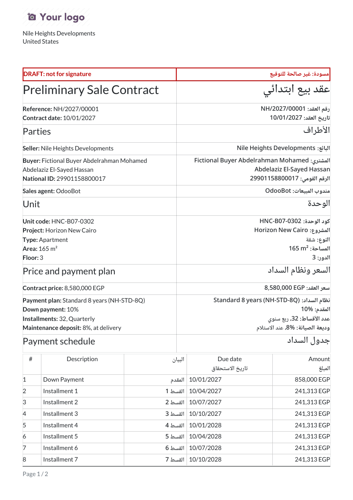
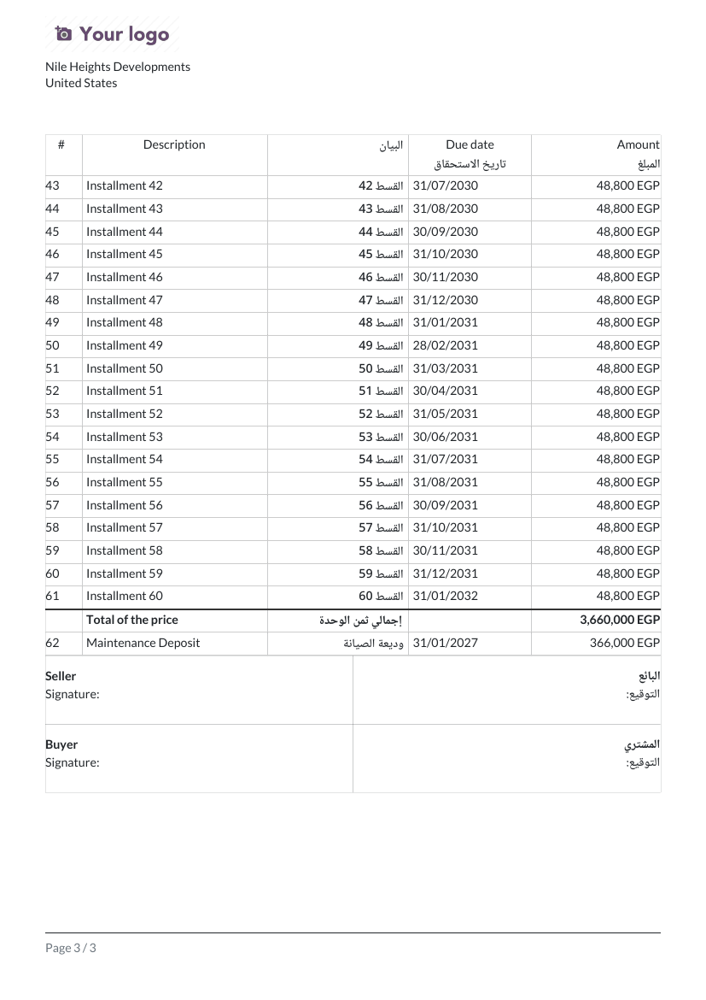

# 08 — Bilingual Arabic / English contract PDF

Plan: [`.squad/plans/installments/08-bilingual-pdf/plan.md`](../../.squad/plans/installments/08-bilingual-pdf/plan.md)

Story 08 prints a contract as one PDF with English on the left and Arabic on the right, row by
row, the way Egyptian sale contracts are laid out: the parties, the unit, the price, the payment
plan and the full schedule (US-07, BR-38). A draft prints with a "not for signature" mark, and
the page ends with signature boxes for both parties.

## What was added

| Piece | Holds | Rules |
|---|---|---|
| `report.paperformat` `paperformat_contract` | A4 portrait, margins for the company header | BR-38 |
| `ir.actions.report` `action_report_contract` | "Contract (Arabic / English)" in the contract's Print menu | US-07 |
| `report_contract`, `report_contract_document`, `report_contract_line`, `report_contract_amount` (QWeb) | the two-column layout, the schedule table, the amount format | BR-38, AC-07.1–07.3 |
| `report.real_estate_eg.report_contract` (`AbstractModel`) | the Arabic words for the selection values, beside their English labels | BR-38 |
| `static/src/css/contract_report.css` (in `web.report_assets_common`) | the Arabic font, equal columns, wrapping, the repeating table header | AC-07.2, S08.1 |
| `docker/Dockerfile.ci` | the pinned Odoo image plus `fonts-noto-core` | S08.1 |

## Two columns, not the translation system

Odoo's translation system prints a report in *one* language: the user's, or the partner's. A
bilingual contract needs both on the same page, so the Arabic words are fixed labels in the
template, in a right-hand cell marked `dir="rtl"`. Only labels are bilingual. The data (names,
codes, amounts, dates) is stored once and printed as typed on both sides.

The words for selection values ("Apartment" / "شقة", "Quarterly" / "ربع سنوي", …) live in one
dictionary in the report model, not in `t-if` chains in the template. Odoo finds that model by
its name, `report.<report_name>`, and merges what `_get_report_values()` returns into the
template's values. A test compares the dictionary's keys with each field's selection, so a new
unit type without an Arabic word fails a test instead of printing an empty cell.

## The font, and why the CI image changed

wkhtmltopdf draws Arabic with the font the CSS names. Arabic letters change shape depending on
their neighbours. A font without those joined forms prints them apart, which is unreadable. The
CSS names **Noto Naskh Arabic**. On Debian / Ubuntu it is in `fonts-noto-core` (README,
*Requirements*). The pinned `odoo:19.0` image has no Arabic font at all, so
`docker/Dockerfile.ci` adds the package on top of the same pinned digest. `make test-ci` builds
it (`run --build`).

The automatic check (T4) prints a real PDF and looks for the font's name inside it. Whether the
letters *look* joined is checked by eye on a printed page. Run in the plain image, without the
font, T4 fails (N5), so the CI test does depend on the image.

## Bidi: what moves inside a right-to-left cell

The Unicode bidi algorithm reorders mixed text. In a right-to-left paragraph, `8,580,000 EGP`
displays as `EGP 8,580,000`, and `Fictional Office Buyer Co.` as `.Fictional Office Buyer Co`.
Every data value on the Arabic side sits in a ``, so it keeps its order. The
Arabic words around it stay right-to-left.

## Amounts and dates

- **Amounts.** The `monetary` widget prints the currency *symbol* and two decimals:
  `8,580,000.00 LE` (EGP's symbol in Odoo). AC-07.3 wants `8,580,000 EGP`. The template uses the
  `float` widget with `precision` 0 (the language still adds the thousands separators) and the
  currency's code. Both sides use Western digits, as developers' printed schedules do.
- **Dates.** The first printed page showed 10 Jan 2027 as `01/10/2027`, the US order of the
  user's language. An Egyptian reader takes that for 1 October. Every date now prints
  `dd/MM/yyyy` (the `date` widget's `format` option).

## Long names and long schedules

The two columns are 50 % each with `table-layout: fixed`, and long words wrap
(`overflow-wrap`). A 60-character name breaks onto a second line inside its column instead of
pushing the Arabic column off the page (AC-07.2). Example C's 62 lines run over three pages: the
`thead` repeats on each page and no row is split (`page-break-inside: avoid`). Rows are numbered
by their place in the whole schedule. The deposit row comes after the total, from a second
loop, and the first version numbered it 1 (see *Mistakes caught*).

## Testing a report

In a test run, `_render_qweb_pdf()` returns **HTML**, not a PDF, unless the context has
`force_report_rendering`. So T1–T3 and T5 read the HTML with `lxml`. "On the Arabic side"
means "inside an element with `dir="rtl"`", and T1 also checks that every Arabic letter on
the page is inside one.

T4 makes a real PDF, and this needed two things:

- **wkhtmltopdf fetches the CSS over HTTP** from `report.url` (else the base URL). The test
  points `report.url` at the test server's port.
- **The test's data is not committed.** wkhtmltopdf's requests first waited for the test's
  transaction (a hang). With the registry in test mode they were refused instead: no test
  cookie, and the PDF had no CSS. `TransactionCase.allow_pdf_render()` does both: it shares
  the test cursor and adds the cookie to wkhtmltopdf's command.

## Tests

58 tests (with Story 04), every report rendered as a user from `new_test_user`. Story 08 adds
`test_report.py`:
T1 `test_ac_07_1_bilingual_side_by_side` (Example A, all 34 lines, numbers and both
descriptions), `test_arabic_label_for_every_value`, T2 `test_ac_07_2_long_customer_name`, T3
`test_ac_07_3_amount_format`, T4 `test_s08_1_arabic_font_embedded` (real PDF) and T5
`test_print_draft_and_read_only_roles`.

**The gates were seen failing** (each change undone before committing):

| Check | Change | Result |
|---|---|---|
| N1 | no `dir="rtl"` on the Arabic line cells | T1 fails |
| N2 | amounts with the `monetary` widget | T1 and T3 fail: `8,580,000.00 LE` |
| N3 | the font removed from the CSS | T4 fails |
| N4 | one Arabic word removed (`retail`) | `test_arabic_label_for_every_value` fails |
| N5 | the tests in the plain `odoo:19.0` image, without the font | T4 fails |

**Manual check** on printed samples: joined letters, columns side by side, the long name
wrapping, the header repeated over pages.

| Example A, page 1 (61-character name, draft mark) | Example C, page 3 of 3 (62 lines) |
|---|---|
|  |  |

## Open questions

- **Arabic data.** A company or customer name is stored in one script. An Arabic name for the
  company (and the projects) would let the Arabic side read fully in Arabic. That needs a new
  field, outside this story.
- **Legal wording.** The PDF holds the data of BR-38 only. Clauses come from the developer's
  lawyer.
- **The UI in Arabic** (`i18n/ar.po`) is separate and not done.

## Alternatives considered

- **Odoo's translation system** (`t-lang`, one report per language). It prints one language
  per page, and a bilingual contract needs both side by side.
- **Bundling the font file inside the module** (`@font-face`). It would work without a system
  package, but it adds a binary font to the repository. A font package installed once, as the
  intake asks, is simpler and is the same on the developer's machine and in CI.
- **An inline `<style>` in the template**, so wkhtmltopdf would not need to fetch the CSS.
  Rejected: reports in Odoo load their CSS from the `web.report_assets_common` bundle, and the
  test can reach the server with `allow_pdf_render()`.
- **Eastern Arabic digits** (٨٬٥٨٠٬٠٠٠) on the Arabic side. Two forms of the same number invite
  disputes. Western digits on both sides, as printed schedules use.

## Explain-back questions

Answer in your own words in [`../learning-log.md`](../learning-log.md#story-08--bilingual-arabic--english-contract-pdf).

1. Why is the Arabic text written as fixed labels in a second column and not with Odoo's
   translation system? Why does every amount on the Arabic side sit in ``?
   What would `8,580,000 EGP` look like without it?
2. Why did the CI image need its own Dockerfile? What does T4 check, and what does it *not*
   check, which still needs your eyes on a printed page?
3. In a test, `_render_qweb_pdf()` returns HTML. What makes it produce a real PDF? Why did the
   first real-PDF test hang, and what does `allow_pdf_render()` change?
